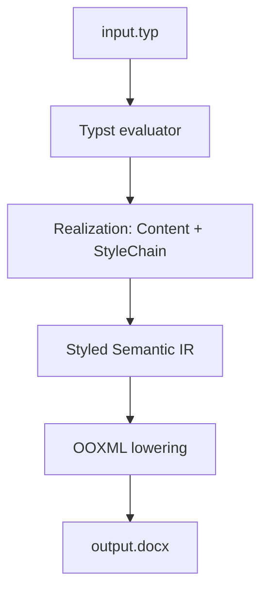
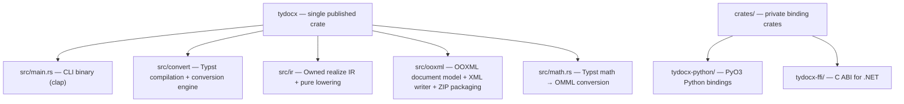

# tydocx

[中文](README.zh-CN.md)

Universal Typst to Word (.docx) converter. Any valid `.typ` file should convert to an editable `.docx`.

## Lineage

tydocx evolved from [dianzuan/typort](https://github.com/dianzuan/typort): it is the branch that takes the compile-backend technical route. It ships for three language ecosystems — the Rust crate itself, Python bindings built with PyO3, and .NET bindings over a small C ABI.

## Install

```bash
cargo install tydocx                    # from crates.io
cargo install --path .                # from a checkout
pip install tydocx                      # Python bindings
dotnet add package Tydocx               # .NET bindings
```

## Usage

```bash
tydocx input.typ -o output.docx
```

Python:

```python
import tydocx

tydocx.convert("input.typ", "output.docx")
docx_bytes = tydocx.convert_to_bytes("input.typ")
```

C# (.NET 8+):

```csharp
using Tydocx;

TydocxConverter.Convert("input.typ", "output.docx");
```

See the [Python](crates/tydocx-python/README.md) and
[.NET](dotnet/Tydocx/README.md) package guides for errors and options.

`--compat c1|c2|c3` selects the compatibility mode (default `c2`),
`--degradation-report path.json` writes the full degradation list, and
`--bibliography-style STYLE.xsl` selects a Word bibliography style: it is
written into `Sources.xml` (`SelectedStyle`/`StyleName`) so Word re-renders
citations and bibliography entries with that style on field update. The
cached field result keeps the document's own CSL render — the XSL is a
Word-side transform — so the conversion reports a `bibliography-style`
degradation naming what a field update will change.

Layout (page margins, footnote style, …) is controlled entirely by the
Typst source (`#set page(margin: …)`, `#set footnote(numbering: …)`); there
are no sidecar presets.

## What it does

tydocx compiles your Typst document and generates a Word file directly — no intermediate PDF, no Pandoc, no template required.



## Supported features

| Feature | Status |
|---------|--------|
| Headings (h1–h6) | Heading styles with detected font sizes |
| Bold, italic, underline, strikethrough, highlight, superscript, subscript, small caps | Full formatting |
| Math (inline & display) | OMML: fractions, scripts, pre-scripts, roots, n-ary operators (sum/integral/…) with operands, named functions, limits, matrices, vectors, accents, bars, cases, aligned equations, over/under braces & brackets; styled variants (bold/blackboard/calligraphic/upright) rendered as styled Unicode glyphs |
| Tables | colspan, rowspan, multi-paragraph cells, nested tables, cell shading; proportional column widths from `(1fr, 2fr, …)`/relative tracks; three-line vs boxed borders detected from drawn rules |
| Lists | Ordered/unordered, nested up to 5+ levels, contextual spacing |
| Paragraph indentation | Hanging & first-line indent honored from `#set par(hanging-indent:, first-line-indent:)` (incl. `(amount, all: true)`) |
| Footnotes | Including inside table cells, with formatting and circled numbers |
| Images | PNG, JPG embedded; SVG rasterized via resvg; vector drawings (CeTZ plots, diagrams) rasterized via typst-render |
| Code blocks | Detected monospace font, light-gray background shading |
| Cross-references | `@label` to bookmarks + REF field codes |
| Hyperlinks | With preserved formatting (bold links, etc.) |
| Page breaks | Detected via Introspector page boundaries |
| Column breaks | `#colbreak()` to `w:br type="column"` (recovered from source) |
| Section breaks | Auto-detected from page setting changes |
| Headers & footers | Extracted from page margin zones |
| Page numbering | `#set page(numbering: "1")` to PAGE field code |
| Columns | `#page(columns: N)` to `w:cols` |
| Table of contents | `#outline()` to TOC field code |
| Horizontal rules | `#line()` to paragraph border |
| Figure captions | Combined into single paragraph |
| Grid layouts | Recovered with tab stops |
| Show rule styling | Font, size, color, bold, italic per-run from rendered output |
| Equation numbering | Chapter-aware `(1.1)` format |
| CJK typography | Kinsoku, overflow punct, auto-spacing, justify, font mixing |
| Document metadata | Title + author from `#set document(...)` |
| Package support | `@preview/...` packages downloaded automatically |

## How it works

tydocx is a real DOCX compiler backend, not a format converter. Compilation realizes the document into `typst-realize` `(Content, StyleChain)` pairs: every element with the style chain that applies to it (plus a companion Paged compile for geometry the pairs cannot carry). Styles are computed from the `StyleChain`, never inferred back from rendered glyphs. Layout content (`#align`, `#place`, `#grid`, …) is positioned naturally while walking the Content tree — no geometric recovery afterwards.

The pairs lower into an owned **Styled Semantic IR** (plain data, no lifetimes), and a pure lowering turns the IR into WordprocessingML, OMML for math, and DrawingML for vector graphics, packaged as a `.docx`. Nothing is hardcoded for any particular document. See [`docs/ARCHITECTURE.md`](docs/ARCHITECTURE.md) for the full design, [`docs/spec-ecma376.md`](docs/spec-ecma376.md) for the OOXML output contract and compatibility-level feature map, and [`docs/fallback-registry.md`](docs/fallback-registry.md) for the live gaps (the legacy tag-walker path is kept as an explicit fallback and equivalence baseline).

OOXML XML is generated directly via `quick-xml`. No docx-rs, no intermediate format.

## Architecture



## Prerequisites

Building from source vendors OpenSSL (`vendor-openssl` in `Cargo.toml`).
On Fedora 44 the vendored OpenSSL build needs Perl `Time::Piece`, which is
not in the base install:

```bash
sudo dnf install perl-Time-Piece
```

To use the system OpenSSL instead:

```bash
OPENSSL_NO_VENDOR=1 cargo build --workspace
```

## Build & test

```bash
cargo build --workspace
cargo test --workspace
cargo clippy --workspace -- -D warnings
cargo fmt --all -- --check
```

## Releases

Pushing a `vMAJOR.MINOR.PATCH` tag runs CI, builds and tests the Python and
.NET packages, and publishes to crates.io, PyPI, and nuget.org.

## Known limitations

- **OMML** does not support math coloring, extensible arrows, or strikethrough/cancel
- **Word** forces Cambria Math font in math zones
- **Ruby annotations** (`w:ruby`) — Typst 0.15 has no native ruby support

## License

Apache-2.0
