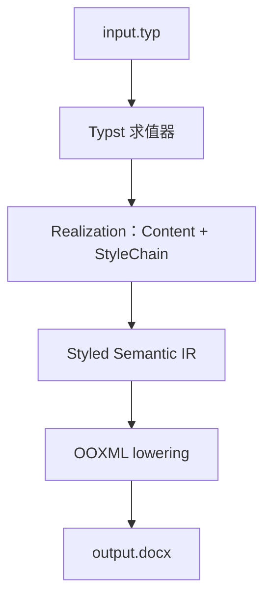
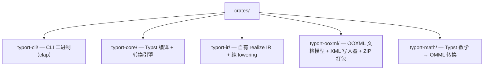

# typort

[English](README.md)

通用的 Typst 到 Word（.docx）转换器。任何合法的 `.typ` 文件都应能转换为可编辑的 `.docx`。

## 安装

```bash
cargo install typort                    # 从 crates.io 安装
cargo install --path crates/typort-cli  # 从 checkout 安装
```

## 用法

```bash
typort input.typ -o output.docx
```

版式（页边距、脚注样式等）完全由 Typst 源码控制（`#set page(margin: …)`、`#set footnote(numbering: …)`），没有外部预设。

## 功能

typort 直接编译 Typst 文档并生成 Word 文件，不经过 PDF，不用 Pandoc，不需要模板。



## 支持的功能

| 功能 | 状态 |
|---------|--------|
| 标题（h1–h6） | 标题样式，字号自动检测 |
| 粗体、斜体、下划线、删除线、高亮、上标、下标、小型大写 | 完整格式 |
| 数学（行内与独立） | OMML：分数、上下标、前置上下标、根式、n 元算符（求和/积分/……）及操作数、命名函数、上下限、矩阵、向量、重音、横线、cases、对齐公式、上/下大括号与方括号；样式变体（粗体/黑板体/花体/直立体）渲染为带样式的 Unicode 字形 |
| 表格 | 跨列、跨行、多段落单元格、嵌套表格、单元格底色；列宽按 `(1fr, 2fr, …)`/相对轨道成比例；三线表与带框表按实际绘制的线检测 |
| 列表 | 有序/无序，嵌套 5 层以上，上下文间距 |
| 段落缩进 | 悬挂缩进与首行缩进，按 `#set par(hanging-indent:, first-line-indent:)` 处理（含 `(amount, all: true)`） |
| 脚注 | 包括表格单元格内的脚注，带格式与圈号 |
| 图片 | PNG、JPG 内嵌；SVG 经 resvg 栅格化；矢量绘图（CeTZ 图、示意图）经 typst-render 栅格化 |
| 代码块 | 检测等宽字体，浅灰底色 |
| 交叉引用 | `@label` 到书签 + REF 域 |
| 超链接 | 保留格式（粗体链接等） |
| 分页符 | 按 Introspector 的页边界检测 |
| 分栏符 | `#colbreak()` 到 `w:br type="column"`（从源码恢复） |
| 分节符 | 按页面设置变化自动检测 |
| 页眉页脚 | 从页边区提取 |
| 页码 | `#set page(numbering: "1")` 到 PAGE 域 |
| 分栏 | `#page(columns: N)` 到 `w:cols` |
| 目录 | `#outline()` 到 TOC 域 |
| 水平线 | `#line()` 到段落边框 |
| 图注 | 合并为单个段落 |
| 网格布局 | 用制表位恢复 |
| Show 规则样式 | 每 run 的字体、字号、颜色、粗体、斜体取自渲染结果 |
| 公式编号 | 章节感知的 `(1.1)` 格式 |
| CJK 排版 | 禁则、溢出标点、自动间距、两端对齐、字体混排 |
| 文档元数据 | 标题与作者取自 `#set document(...)` |
| 包支持 | `@preview/...` 包自动下载 |

## 工作原理

typort 是真正的 DOCX 编译后端，不是格式转换器。编译把文档 realize 为 [`typst-realize`](docs/spike-realize.md) 的 `(Content, StyleChain)` 对：每个元素连同适用于它的样式链（另加一次伴生 Paged 编译，补 pairs 拿不到的几何信息）。样式由 `StyleChain` 计算得到，绝不从渲染后的字形反推。布局内容（`#align`、`#place`、`#grid`、……）在遍历 Content 树时天然有位置，不再事后按几何找回。

这些对降为自有的 **Styled Semantic IR**（纯数据，无生命周期），再由纯 lowering 把 IR 转为 WordprocessingML、数学的 OMML、矢量图形的 DrawingML，打包为 `.docx`。不针对任何特定文档硬编码。完整设计见 [`docs/ARCHITECTURE.md`](docs/ARCHITECTURE.md)，迁移状态见 [`docs/PLAN-docx-backend.md`](docs/PLAN-docx-backend.md)（步骤 1–2，编译/导出分离与 realize 路径，均已完成；旧 tag-walker 路径保留为 fallback 与等价性基线）。

OOXML XML 直接用 `quick-xml` 生成。不用 docx-rs，无中间格式。

## 架构



## 构建与测试

```bash
cargo build --workspace
cargo test --workspace
cargo clippy --workspace -- -D warnings
cargo fmt --all -- --check
```

## 已知限制

- **OMML** 不支持数学着色、可伸缩箭头、删除线/取消线
- **Word** 会强制数学区使用 Cambria Math 字体
- **注音**（`w:ruby`）——Typst 0.15 没有原生注音支持

## 许可证

Apache-2.0
