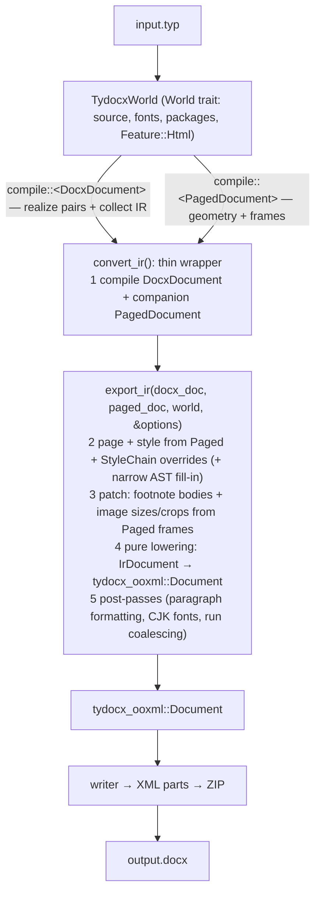
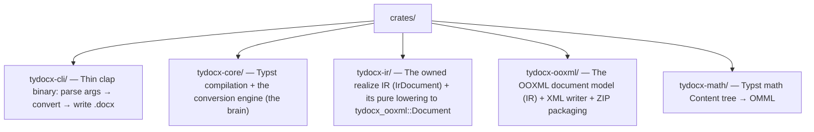

# tydocx Architecture

This document explains how tydocx turns a Typst document into an editable Word
file. It is written for newcomers to the codebase. For build and contribution
rules, see [`AGENTS.md`](../AGENTS.md) in the repository root.

## The problem

A `.typ` file is a *program*. Running it produces a laid-out document. Converting
that to a `.docx` is hard for one reason: **the two formats disagree about what a
document *is***.

- Word is **semantic and reflowable**: a heading is a heading (style `Heading 1`),
  a footnote is a native footnote, a table is a grid of cells, an equation is an
  editable OMML object. There are no "pages" in the content model — Word paginates
  on its own.
- A rendered Typst document is **geometric**: glyphs placed at coordinates on
  fixed-size pages. By the time it is laid out, "this is a heading" has decayed
  into "these glyphs are 22pt and bold."

A naive converter renders Typst to pages (or PDF) and reconstructs Word from the
geometry. That path is lossy — headings become bold text, footnotes become
page-bottom paragraphs, cross-references break. tydocx exists to avoid exactly
that. (See the competitor analysis in the project notes: PDF-intermediate tools
are fundamentally lossy.)

## The core idea: read the document from two representations, plus narrow source-AST exceptions

tydocx compiles the **same source** more than once, because no single
representation carries everything Word needs. The primary sources, in order
of authority:

| Source | Produced by | Carries | Used for |
|--------|-------------|---------|----------|
| **Realize pairs** | `typst::compile::<DocxDocument>` (`Target::Paged`, via `typst-realize`) | element identity + document order + the `StyleChain` that applies to each element + an *introspector* | the skeleton *and* the paint: what each thing *is*, what order it comes in, and how it is formatted — including declared `set` values, which live in the chains |
| **Paged geometry** | `typst::compile::<PagedDocument>` (companion compile) | footnote entry bodies, on-page image display sizes and clip windows, page dimensions, headers/footers, page numbering | what the pairs cannot carry: footnote bodies, image sizes/crops, page-level facts |
| **Source AST** (narrow exceptions only) | re-parsing the `.typ` text | values consumed before the chain (declared font spelling — `FontFamily::new` lowercases it), values no chain can see (`set` rules inside imported modules that own no content), and facts about consumption (whether a `show` rule re-emitted `it`, `counter(footnote).update(0)`, `counter(page).at(<label>)` targets) | a fill-in under the chain-derived values — never the primary read |

The mental model:

> **The realize pairs are the skeleton and the paint** (semantics + order +
> styles, straight from the evaluator — the `StyleChain` is the authoritative
> declared value, the same place Typst itself reads it). **Paged supplies
> only what the pairs cannot** (footnote entry bodies, image display sizes
> and crops, page-level facts). **The source AST is a gap-fill** for values that provably
> never reach a chain — not a third authority.

The legacy `HtmlDocument` tag-walker path is kept as `convert_legacy` /
`export` — the explicitly-injected fallback and the equivalence baseline
for the realize path (see `docs/fallback-registry.md`). It is not the
conversion path anymore; on that path the source AST remains a full third
source (it predates the chain work).

### Why realization replaced HTML

The legacy path walked `HtmlDocument`'s tag sequence. Typst's HTML export
deliberately omits visual information and drops content that has no
semantic HTML representation:

- **No styling values.** `<h1>` tells you "heading"; it does *not* tell you the
  font, the exact point size, the RGB color, or the alignment. Those exist only in
  the rendered frames. The legacy path reverse-engineered them from Paged geometry
  (`convert/page/style.rs` and `convert/page/run_style.rs`). The realize pairs
  carry the `StyleChain` with each element, so the styles are read directly —
  never inferred back from rendered glyphs.
- **Layout-only constructs vanish.** `#align(center)[...]`, `#place(...)`, some
  `#grid(...)` layouts, and `#line()` rules have no HTML element, so they are
  *absent from the DOM*. The legacy path used to recover them by diffing rendered
  text lines against the model (`convert/recovery/` — deleted in step 4; the
  equivalence baseline now runs without it). In the realize path, elements
  that only exist after layout (a table's synthesized `grid`, a figure body's
  caption) are resolved by **fragment re-realization**: the enclosing body is
  realized a second time as a `Fragment` with the same engine and a locator
  derived from the main one, and the fragment's tags carry the synthesized
  element.
- **Page-level facts don't exist before pagination.** Page size, margins, columns,
  headers/footers (which live in the page-margin zones), foreground/background
  layers and page fill (which only exist in the final page frame's paint
  order), page breaks, and page numbering only come into being once the
  document is laid out — i.e. only from Paged. The realize path still takes these from the companion `PagedDocument`
  (route (b)), as an explicit patch step (`convert/realize/patch.rs`).
- **Math is MathML, not OMML.** The HTML target (typst 0.15) renders equations to
  **MathML** `<math>` elements — semantic, but not what Word edits. Both paths
  pull the original `EquationElem` Content tree through the **introspector** and
  convert it to OMML (`tydocx-math`); the HTML walk skips the `<math>` node so
  the equation's glyphs aren't re-emitted as duplicate literal text
  (`convert/inline_walk.rs`, `"math"` arm), and the realize collector
  likewise emits only the OMML, not the equation's rendered text pairs.
  MathML→OMML transliteration is a possible
  future alternative, but the Content tree is the richer source today.
- **The realize target is `Paged`, not `Html`.** `Target` has no `Docx`
  variant, so a custom `Output` picks an existing one. Under `Target::Html`,
  `realize`'s verdict applies the Html-specific built-in show rules
  (`TABLE_RULE` and ~37 others, registered for Html only): a `TableElem` in
  the pairs is already rewritten to `<table>` — cells keep only
  colspan/rowspan; fill, stroke, inset, align, and track widths are gone.
  Under `Target::Paged` the Paged rules (59 in 0.15.1) rewrite elements into
  `BlockElem`/`ParElem` containers plus rendered text — the element's fields
  stay materialized and its identity stays in the tag stream, much closer to
  DOCX's block model. `Target::Paged` also requires no `Feature::Html` and
  avoids the "html export is under active development" compile warning.

### Why Paged alone is not enough

The rendered document has lost the semantics. A heading is just large bold
glyphs; a footnote is just text near the bottom of a page; a table is just lines
and text boxes. Building Word from geometry alone is the lossy PDF→Word path we
are explicitly avoiding. The realize pairs are what let tydocx emit **native** Word headings,
footnotes, and cross-references.

### Why the source AST still exists (narrowly)

Heuristics from geometry are a *fallback*, and the `StyleChain` is the
primary declared-value source — but a few values provably never reach a
chain:

- **Declared font spelling.** `FontFamily::new` lowercases the family name
  before it enters the chain (`"Libertinus Serif"` → `"libertinus serif"`),
  but OOXML and CJK `eastAsia` selection need the declared spelling.
- **Imported-module `set` rules** apply only to the module's own content;
  when it has none, no pair carries the value. The AST scan
  (`extract_source_style_overrides` over reachable files) treats their
  top-level rules as document-global, so `merge_from` keeps them for fields
  the ambient chains leave unset.
- **Consumption facts.** `show heading:`/`show outline.entry:` rewrite the
  element during realization — whether `it` was re-emitted is unobservable
  in the pairs. `counter(footnote).update(0)` is locatable, but
  `CounterUpdateElem::key` is private in typst 0.15. `counter(page).at(<label>)`
  reference targets likewise need the source span lookup.

Document-global overrides are resolved by `convert/realize/chain.rs` from the
`TagElem` marker pairs' chains — the ambient document-scope state that
element-internal styling never contaminates — and `merge_from` fills only the
fields no chain could provide.

## The pipeline

`tydocx_core::convert::convert(world, &options) -> Result<ConvertOutcome, Vec<SourceDiagnostic>>`
is the heart of the system. It is a thin wrapper: it compiles the realize
document and a companion `PagedDocument` (`convert_ir`) and hands them to
`export_ir`, which lowers the collected IR. `export_ir(docx_doc, paged_doc, world, &options) -> ConvertOutcome`
is the backend-shaped entry point — callers that already hold compiled
documents (a host compiler, a test) use it instead of `convert`. The outcome
pairs the document with its degradation report (`ConvertOutcome { document, degradations }`);
the compat mode rides in `ConvertOptions` (see `docs/spec-ecma376.md`). Compilation failures keep
their spans: they are returned as `Vec<SourceDiagnostic>`, never as plain
strings. The steps are grouped here by purpose; see the numbered comments in
`crates/tydocx-core/src/convert/realize/mod.rs` for the exact order.

Two design properties worth knowing:

- **Graceful degradation.** Paged compilation is treated as optional
  (`paged_result.output.ok()`). Every Paged-dependent step is guarded by
  `if let Some(paged)`, so if only the realize compile succeeds,
  conversion still produces a document — footnotes keep their markers
  literally, but images keep their 0 size (the intrinsic-size fallback
  lives in the patch, which needs Paged; see
  `docs/fallback-registry.md`).
- **The pairs drive order.** The realize pair walk (`collect_document`)
  defines document order. Paged data is matched back onto it — by
  `Location` within the one Paged compile (footnote entry groups, keyed
  by their parent marker location), or by content hash (image display
  sizes and clip-derived crops). `Location` is process-local and is never compared across
  compiles or persisted. Image bytes need no matching: they travel in
  the pairs' `ImageElem` content.

The legacy path (`convert_legacy` → `export`) is the same shape with a
different skeleton: it compiles `HtmlDocument` + `PagedDocument` and walks
the HTML tags (`walk_tags`) through pipeline phases 2–5 (page + style,
HTML body walk, headers/footers, post-processing). It stays
as the fallback and the equivalence baseline; its recovery passes were
deleted in step 4 once the realize path proved it covers the same content
natively (the per-item evidence is in `docs/fallback-registry.md`).

## Crate layout

`tydocx-ooxml/src/lib.rs` is the crate's public API index: it contains only module
declarations and re-exports. Its writer tests live in `tydocx-ooxml/tests/`, where
they exercise that public API as integration tests.

### tydocx-ooxml writer internals

| File | Responsibility |
|------|----------------|
| `writer/mod.rs` | Package entry point (`write_docx`), write context, and inventory of optional parts/relationships. |
| `writer/package.rs` | ZIP/package plumbing, content types, relationships, settings, core properties, and shared XML helpers. |
| `writer/document.rs` | Main document body and section properties. |
| `writer/paragraph.rs`, `writer/run.rs`, `writer/table.rs` | WordprocessingML paragraphs, inline runs, and tables. |
| `writer/numbering.rs`, `writer/footnotes.rs`, `writer/fields.rs` | Numbering definitions, footnote parts/references, and Word fields/bookmarks. |
| `writer/math.rs`, `writer/image.rs`, `writer/citation.rs` | OMML passthrough, DrawingML images/media inventory, and citation/bibliography XML. |
| `writer/header_footer.rs` | Header and footer parts, including automatic page numbering and anchored furniture drawings (`wp:anchor` text boxes, pictures, solid-fill shapes) with part-local image relationships. |

### tydocx-core internals

| File | Responsibility |
|------|----------------|
| `world.rs` | `TydocxWorld`: implements Typst's `World` trait (source, system fonts, `@preview` package download, `Feature::Html`). |
| `convert/mod.rs` | Entry orchestration: `convert` (the realize path, thin wrapper over `convert_ir`) and `convert_legacy`/`export` (the legacy HtmlDocument pipeline, kept as fallback and equivalence baseline), module declarations/re-exports, `WalkCtx`, equation state, and the legacy pipeline phases. |
| `convert/realize/mod.rs` | The realize path: `DocxDocument: Output` (`Target::Paged`, collects the IR during `create`), `with_fragment` (fragment re-realization), `convert_ir`/`export_ir` (page/style via a scratch `Document`, patch, pure lowering, path-independent post-passes), and the core↔ir `CompatMode`/`Degradation` boundary conversions. `DocxDocument`'s `introspector()` is an `ElementIntrospector` fed from the pairs' tag stream; the feed **must recurse into `ParElem`/`BlockElem` bodies** for nested `TagElem`s — top-level-only collection leaves `CiteGroup`s undiscovered and fails the final compile round ("citation could not be located"). |
| `convert/realize/collect.rs` | Pair → `IrDocument` collection: the tag-group walk, label/bibliography pass, footnote markers, and fragment-resolved tables/grids/figures. |
| `convert/realize/inline.rs` | Pair → `IrInline` collection: runs from `StyleChain`, links, refs, cites, images, math, breaks. |
| `convert/realize/style.rs` | `StyleChain` → `Run` conversion (weight/style/size/color/font, smart quotes, run-merge key). |
| `convert/realize/patch.rs` | Companion-Paged patch: footnote entry bodies from frame groups and image placements (display size + clip-derived `a:srcRect`) by content hash (with the intrinsic fallback). |
| `convert/realize/place.rs` | Companion-Paged patch: `#place` geometry — each float's frame group (keyed by the place's `Location` in `FrameParent`) and each non-floating place's `Tag` bracket (the placed items' union bounds between `Tag::Start`/`Tag::End`) become a page-absolute `IrAnchor`. At lowering, an anchor feeds `wp:anchor` emission (non-floats carry `wp:wrapNone` and a `behindDoc` flag from paint order; an unfilled text box paints the colour of what it covers — the latest covering placed `rect`, else a declared solid `page(fill:)`, else paper; a box fully inside a side margin anchors `relativeFrom="margin"`) or `w:tblpPr` when the body is a lone table. |
| `convert/block.rs` | Block-level HTML tag walk and dispatch, paragraphs, equations, figures, code blocks, blockquotes, and term lists. |
| `convert/inline_walk.rs` | HTML inline traversal: formatted spans, links, citations, footnotes, images, and inline equations. |
| `convert/headings.rs` | Semantic heading conversion, numbering, smart quotes, and inline heading content. |
| `convert/tables.rs` | HTML table conversion, cells and nested tables, plus rowspan post-processing. |
| `convert/lists.rs` | Ordered and unordered HTML list conversion, including nested levels. |
| `convert/source.rs` | Gathers and applies authoritative source-AST style and paragraph overrides. |
| `convert/smallcaps.rs` | Recovers consumed `smallcaps` calls and aliases from the source AST. |
| `convert/postprocess.rs` | Paragraph-indent cleanup and document metadata extraction. |
| `convert/dom.rs` | Shared HTML DOM, tag, attribute, text, location, and alignment helpers. |
| `convert/page/mod.rs` | Paged-style facade: declares responsibility modules and re-exports their caller-facing API. |
| `convert/page/units.rs`, `convert/page/style.rs` | Word-unit conversion and document-style detection from rendered frames. |
| `convert/page/source_ast.rs`, `convert/page/hanging_indent.rs`, `convert/page/reachable.rs` | Authoritative source-AST `set`-rule parsing (including scoped hanging indents) and reachable local-source collection. |
| `convert/page/margin.rs` | Page settings, body/margin zones, headers, footers, and page numbering from Paged geometry. Furniture-aware: artifact/`#place` bracket content is excluded from the zone's literal text so it can anchor instead of duplicating. |
| `convert/page/furniture.rs` | Page `foreground:`/`background:`/`page(fill:)` and header/footer-zone `#place` → `wp:anchor` drawings inside header/footer parts at C2/C3. Zones are classified off the page frame's paint order and `ArtifactElem`/`Tag` brackets; a body `#place` (matched by location hash against the IR) is never furniture — it already anchors in `document.xml` — and introspection-only tags (`metadata`, counter/state updates) can be neither inner content nor the untagged-foreground start. Each furniture unit is measured into an `AnchoredFloat` (`relativeFrom="page"`, `wps:txbx` text, `pic:pic` images, `a:solidFill` rects and full-page solid fills). The layer's page-variation signature picks the OOXML slot — uniform → default, first-vs-rest → `first` + `w:titlePg`, odd/even → `even` + `w:evenAndOddHeaders`; per-physical-page variation and unsupported unit content (non-solid fills, transforms/clips) report `page-foreground`. C1 keeps the literalized-text contract. |
| `convert/page/run_style.rs`, `convert/page/language.rs` | Per-run rendered-style overrides, measured per-level heading sizes, redundant heading-property suppression, BCP-47 helpers, and localized CJK font names. |
| `convert/text_norm.rs` | CJK-space normalisation shared by the HTML walk (the recovery-side normalisers went with `convert/recovery/`). |
| `convert/coalesce.rs` | Final pass: merges same-line paragraphs, coalesces adjacent runs with identical effective `rPr`, and folds whitespace-only runs. |
| `convert/table_width.rs` | Turns a `TableElem`'s declared column `TrackSizings` (fr/rel/auto) into per-cell `w:tcW` percentages. |
| `convert/table_align.rs` | Faithful table-cell alignment from the semantic `TableElem`: horizontal → cell-paragraph `w:jc`, vertical → `w:vAlign`. |
| `convert/breaks.rs` | Explicit `#pagebreak()`/`#colbreak()` recovery from the source AST (both are consumed at compile time), positioned by run spans, expanding local function calls, and following `#include` chains. |
| `convert/bibliography.rs` | Citation data via the semantic `BibliographyElem` (+ re-parsing `.bib`/`.yml` with hayagriva). Takes `&dyn Introspector`, so both conversion paths share it (legacy: HtmlDocument's introspector; realize: DocxDocument's). |
| `convert/footnote.rs` | Footnote bodies from the HTML `doc-endnotes` section. |
| `convert/image.rs` | Image content decoded from each ``'s base64 src data-URL (typst-html 0.15 embeds the bytes in the DOM); Paged frames contribute display sizes and clip-derived `a:srcRect` crops (by content hash — the frame walk accumulates `GroupItem::clip` windows, the mechanism both `clip:` and `fit:` route through) and drawing-canvas SVG+raster pairs keyed by their figure's `Location`. |
| `convert/inline.rs` | Typst Content-AST inline formatting (bold/italic/…) → styled runs. |

## The IR: `tydocx_ooxml::Document`

This is the typed contract between the two halves of the system. `tydocx-core`
**writes** it; `tydocx-ooxml::writer` **reads** it; it is the only thing they
share.

- `Document` — root: body elements, footnotes, page settings, document style,
  header/footer, page numbering, citation sources, metadata.
- `BlockElement` — `Paragraph | Table | BibliographyBlock` (the bibliography
  section, wrapped in an SDT carrying a `BIBLIOGRAPHY` field code).
- `Paragraph` — inline runs + optional `ParagraphStyle` + alignment/indent/spacing.
- `InlineElement` — `Text(Run)`, images, footnote refs, breaks, fields/bookmarks.
- `Run` — a styled text span (bold/italic/underline/color/font/size/script).
- `Table` / `TableRow` / `TableCell` — colspan/rowspan, shading, borders,
  multi-paragraph cells.
- `ParagraphStyle` — a **typed enum** (`Normal` | `Heading(n)`) rather than
  stringly-typed style IDs. Code blocks ride a `code_block` flag on the
  paragraph (the `CodeBlock` style), quotes a left indent.

Units are stored in **Word-native form** (half-points for size, twips for
spacing/indent) so the writer does minimal conversion.

## The realize IR: `tydocx_ir::IrDocument`

Between the realize pairs and `tydocx_ooxml::Document` sits a second,
owned IR — the **Styled Semantic IR** (`crates/tydocx-ir`). The pairs
borrow the realize arenas and cannot outlive `create()` — and `create()`
runs once per round of the compiler's introspection-convergence loop, so it
keeps no cross-call state — so the collector
copies them into owned data at once: `IrDocument { info, page, style,
body, footnotes, citation_sources }`, with `IrBlock` (14 variants:
Paragraph, Heading, Table, Grid, Figure, List, Enum, Equation, Quote,
Raw, Outline, Bibliography, Place, PageBreak) and `IrInline` (12
variants: Text, Link, Ref, Cite, FootnoteMarker, LineBreak, Space, Image,
Math, PageBreak, ColumnBreak, Tab). Strong/Emph/Super/Sub are **run
attributes**, not inline variants — the Paged show rules already merged
them into `TextElem` by the time the pairs exist, so the IR records them
where the writer reads them (bold/italic/superscript/subscript on `Run`).

Rules the equivalence round established (see
`crates/tydocx-cli/tests/integration/ir_path.rs` for the rulings):

- **Alignment** comes from the pair's `StyleChain` (`AlignElem` in
  scope); justification is document-level (the Normal style's
  `body_alignment`), never per-paragraph.
- **Table borders** are mapped from the fragment grid
  (`table_borders_from_grid`): explicit lines map per side with a header
  separator; with no explicit lines, any cell stroke gives the writer's
  uniform grid and no strokes give nil borders. **Column widths** are
  fiftieths of a percent (5000 = 100%), summed over spanned tracks
  without rescaling.
- **Grids** lower to fixed-layout tables through a pure planner
  (`tydocx-ir::grid_plan`): occupancy is derived from cell `x`/spans,
  empty source rows run-length-merge into single rows with summed
  `w:trHeight`, identical adjacent columns merge into `w:gridSpan`
  lanes, and `rowspan`s become `w:vMerge` (a continuation keeps the
  restart's `w:gridSpan`, so a spanning merge never splits into
  per-lane cells). Strokes resolve per boundary segment the way Typst
  folds them — an explicit line wins, a declared cell edge beats an
  undeclared neighbour, ties go to the inner side — and the winning
  side alone emits the `w:tcBorder`, so whitespace and continuation
  cells never paint borders they do not own. `auto` row heights are
  measured per row (`typst_layout::layout_frame` on the row's cell
  bodies at their resolved widths) instead of equal-sharing the
  fragment total; empty slots get zero cell margins and a 1pt
  paragraph mark. The measured heights are planner input: only the
  rows the planner actually rewrites carry `w:trHeight` — a grid it
  leaves unchanged lowers like an ordinary table so Word reflows
  its rows.
- **Drawn figure bodies** attach their Paged canvas by `Location` hash
  and embed as SVG (`typst_svg`) plus a PNG fallback (`typst_render`)
  inside `mc:AlternateContent`; source SVG images keep their bytes the
  same way. C1 keeps the raster only.
- **Heading sizes** are measured from the collected headings' own runs
  (glyph-weighted dominant size per level); the rank-based histogram is
  only the fallback for levels with no sized run.
- **Citations** arrive in fragments as `RefElem` tags, never `CiteGroup`;
  a ref target that is not a document label is a bibliography key, and
  the collector emits `IrInline::Cite` with the full literal marker text
  (`"[1]"`, `"[1], [2]"`) and `target: None` until bibliography entries
  exist. C1/C2 keep citations as literal markers plus internal links; C3
  lowers them to `CITATION` fields with the literal marker cached (the
  hayagriva sources ride in `customXml/item1.xml` at every level).
- **Footnote markers** in a fragment are single-pass, so an unresolved
  marker reads `"0"` and is replaced by the ordinal; entries are matched
  by `Location` first, then by ordinal order. Footnote entry text is
  excluded from the body-size/font histograms, so it cannot misdetect
  the Normal style.
- **Runs carry their source span** (from the pair content), so span-keyed
  lookups (the `counter(page).at` exception, overline geometry matching)
  locate IR content. **Term lists** are collected as paragraphs: tight items
  are one paragraph (bold term + separator + description), wide items a
  term paragraph plus description blocks.
- **Footnote bodies** are collected from the `FootnoteElem.body` content
  at the marker (the tag group carries only the marker), giving real
  OMML, hyperlinks, and images; the Paged-frame body is the fallback.
  Display equations in a footnote body stay inline `Math` (their OMML
  already carries the `<m:oMathPara>` wrapper). Circled footnote
  numbering comes from the elements' numbering patterns.
- **Page references** (`counter(page).at(<label>)`) are detected in
  fragments from a `ContextElem` tag, the label recovered from the
  source AST via the main source threaded into the Collector, and
  emitted as `IrInline::Ref { page_ref: true }` (PAGEREF field).
- **C3 context fields** — `counter(page).final()`, `counter(footnote)`
  references, `datetime.today()`, and `document.<field>` reads arrive as
  `ContextElem` pairs too; the collector classifies the span's source
  expression and wraps the pair's own rendered inlines in
  `IrInline::Field`, so the cached result is the C2 literal by
  construction. `lower` emits the field only at C3 (a `NOTEREF` also
  requires the label to land on a `FootnoteElem`, which is bookmarked);
  at C1/C2 the wrapper unwraps to the same literal runs.
- **C3 numbering and header fields** — figure/table caption numerals
  (single-piece patterns) are located inside the caption inlines by char
  offset (`IrCaptionSeq`) and spliced into `IrField::Seq` only when the
  lowerer emits the caption at C3, so the IR caption stays identical to
  C2's; equation numbers carry an optional `SEQ` split the
  lowerer prefers at C3; a page zone whose whole content is a heading
  query (detected from source, `page_zone_heading_levels`) is wrapped
  into ` STYLEREF "Heading N" ` by `apply_headers_and_footers`.
  `Document.update_fields` is set at C3 only, emitting `w:updateFields`
  in `settings.xml`.
- **Body defaults** are voted from the leading portion of the document
  only (9,000 glyphs, the pairs-level analogue of the legacy first-3-
  pages rule), so back matter cannot misdetect the body size or font.
- **Inline images** arriving as tags in fragments are collected
  (`ImageElem` branch in `handle_tag_start`); **block elements nested
  in sequence children** are flattened out of the pending inline run
  (`flatten_sequences`), so a display equation inside a `#body`
  substitution is dispatched as a block.

The lowering (`tydocx_ir::lower(ir, geometry, compat) -> (Document,
Vec<Degradation>)`) is a **pure function**: no `World`, no `Engine`, no
`PagedDocument` — geometry arrives as the explicit `GeometryInput {
page_size, page_numbering, supplement, header (_even/_first), footer
(_even/_first), even_and_odd_headers, title_page }` struct. That
purity is what makes the lowering unit-testable (`crates/tydocx-ir` has
its own lib tests) and what lets the two conversion paths share the
writer without sharing a walk.

## The writer: direct OOXML, no library

`tydocx-ooxml::writer` emits the `.docx` XML parts directly via `quick-xml` — **no
`docx-rs`, no intermediate format**. This is a deliberate choice: Word is strict
about WML child-element ordering (`rPr`/`pPr` children must appear in schema
order), and direct emission gives full control. Its root owns package orchestration
and shared write state; part-specific modules emit `document.xml`, `styles.xml`,
`numbering.xml`, `settings.xml`, relationships, content types, headers/footers,
footnotes, citations, math, and media before the entry point zips them.

## Math → OMML

`tydocx-math` converts the Typst math Content tree (obtained *semantically* via
the introspector, not from rendered glyphs) into OMML, which keeps equations
**editable** in Word. It implements a broad set of OMML constructs: fractions
(`m:f`), scripts (`m:sSub`/`m:sSup`/`m:sSubSup`), pre-scripts (`m:sPre`), radicals
(`m:rad`), n-ary operators (`m:nary`), delimiters (`m:d`), matrices (`m:m`),
aligned equations (`m:eqArr`), accents (`m:acc`), bars (`m:bar`), group characters
/ over-under braces (`m:groupChr`), named functions (`m:func`), limits
(`m:limLow`/`m:limUpp`), phantoms (`m:phant`), and boxes (`m:box`). Math **style
wrappers** (e.g. `bold`, `bb`, `cal`, `upright`, `dif`) are resolved to their
styled Unicode glyphs via the `codex` crate Typst itself uses (`bb(R)` → ℝ,
`bold(e)` → 𝒆), with an explicit `m:sty="p"` forcing upright for `upright`/`dif`.

An n-ary operator's operand (the integrand/summand) is bound into its `<m:e>`
body rather than left as detached siblings: Typst stores the operand as flat
content following the operator, so the sequence walker consumes following items
into the operand until a **Relation-class** symbol (`=`, `<`, `→`, …) — using the
same `unicode-math-class` table Typst uses, so the boundary matches Typst's own
classification (e.g. in `sum_i a_i = S`, the `= S` stays outside the n-ary).

**Hard limits** (OMML / Word constraints, not bugs):

- No color inside math zones.
- No extensible arrows.
- Word forces the Cambria Math font in math zones.

## Conformance oracles

The step-5 conformance suite (`tests/integration/conformance.rs`,
`tests/integration/numbering.rs`) pins the backend's structural contract
rather than individual features:

- **Canonical fingerprint** (`tydocx-ooxml/src/canonical.rs`): a
  namespace-aware canonicalization of a generated XML part — qualified
  element names, attributes sorted, per-instance ids (`w:id`, `paraId`,
  `rsid*`) dropped — so comparisons measure the tree, not serialization
  noise. References (`w:numId`, `r:embed`) are kept. The semantic digest is
  the same tree minus attributes: element classes plus text.
- **Paragraph census (REACH):** over the whole fixture corpus, every
  non-empty IR paragraph's text must appear somewhere in the package
  (`word/document.xml` for body text, `word/footnotes.xml` for the
  Paged-sourced footnote bodies), and every non-empty `document.xml`
  paragraph must trace to IR text or a named generated prefix (numbering,
  markers, field results). This pins D8: no silent drops. Paragraphs in
  header/footer parts are sourced from the companion `PagedDocument` —
  the realize pairs carry no page furniture — and account to the named
  `page-furniture` source instead.
- **IR variant coverage:** every `IrBlock`/`IrInline` variant must be
  reached by at least one fixture — the census is only meaningful if the
  corpus exercises the whole inventory.
- **Round-trip and strict validation** (`#[ignore]`d; LibreOffice and
  python-docx are the available oracles — there is no Word in CI or the dev
  environment): every fixture docx must open under python-docx and survive
  a LibreOffice conversion; the round-trip test additionally asserts every
  element class survives or is a named LibreOffice rewrite
  (`w:fldSimple` → `w:fldChar`/`w:hyperlink`, `w:tblBorders` → per-cell
  `w:tcBorders`, empty `w:footnotePr` elided) and the paragraph-text
  multiset is preserved. This environment's LibreOffice lacks the
  `libreoffice-math` component, so it imports OMML as nothing — `m:*`
  classes are unobservable on reopen and exempted as an oracle
  limitation.
- **Preservation:** `preserve_inert_constructs` pins that constructs tydocx
  emits but does not further model (HYPERLINK `w:fldSimple`, heading
  bookmarks + REF fields, footnote references) survive a save + reopen.

## The retired seam: `convert/recovery/` (deleted)

The legacy path had a recovery layer that did, in miniature, the very
PDF→Word inference tydocx set out to avoid — because some content
(`#align(center)`, `#place`, grids) reached the HTML-based model *only* as
geometry. `recovery/mod.rs::recover_missing_content` orchestrated it:
`lines.rs` extracted every rendered text line with its position,
`deduplication.rs` **text-diffed** it against what already made it into the
model, and `insertion.rs` inserted genuinely-missing lines at the
geometrically-correct slot. `horizontal_rules.rs` and `table_rules.rs` held
the two rule-shape paths, and `page/sections.rs` inferred section breaks
from rendered page-size changes.

The realize path never ran any of it — it reads semantics from the pairs
instead of reconstructing them from geometry. In step 4 the whole module
was deleted after the fixture corpus proved every behavior has a native
realize-path equivalent: layout-only blocks, placed content, `#block`/`#rect`
text, `#rotate`/`#move`/`#scale` bodies, grids, shapes, and context/layout
output are collected from the pairs (`realize/collect.rs`), `#line()` rules
come from the `LineElem` pair (`line_blocks`), table borders from the
realized grid strokes (`table_borders_from_grid`), and section breaks from
the collected `PageSnapshot` chains (`ir.sections` → `lower_body` /
`attach_section_break` in `tydocx-ir`). The geometry constants and the
element→page map went with it; the remaining live gaps are recorded in
`docs/fallback-registry.md`.

The same brittleness warning still applies to the surviving Paged-geometry
heuristics under `convert/page/` (per-run styles, margin zones, footnote
bodies, image sizes): geometry → semantics inference can false-positive and
false-negative. **Anyone touching those heuristics should add a
fixture-based regression test for the specific case.**

## Language neutrality (how it stays universal)

tydocx's stated goal is a **universal** Typst→Word converter — it must not bake
in assumptions about a document's language or genre. Earlier versions did, in
three places; all now derive from semantics instead, and they stand as the
pattern to follow:

1. **Bibliographies** are detected via the semantic `doc-bibliography` role from
   `#bibliography(...)`, not by matching a `参考文献`/`References` heading. A
   hand-written reference list is, to Typst, ordinary text — and is converted as
   such.
2. **Figure/table captions** were once deduplicated during recovery by
   matching `表 `/`图 `/`Table `/`Figure ` prefixes; the dedup that replaced it
   compared semantic emitted text, and with recovery deleted each caption is
   simply emitted once by the element's own walk.
3. **Document language** (`w:lang`) is derived from `#set text(lang:, region:)`,
   not guessed from the presence of CJK glyphs.

If a future change reintroduces `if text.contains("<word>")` to drive layout,
it regresses this principle. See `AGENTS.md`.
