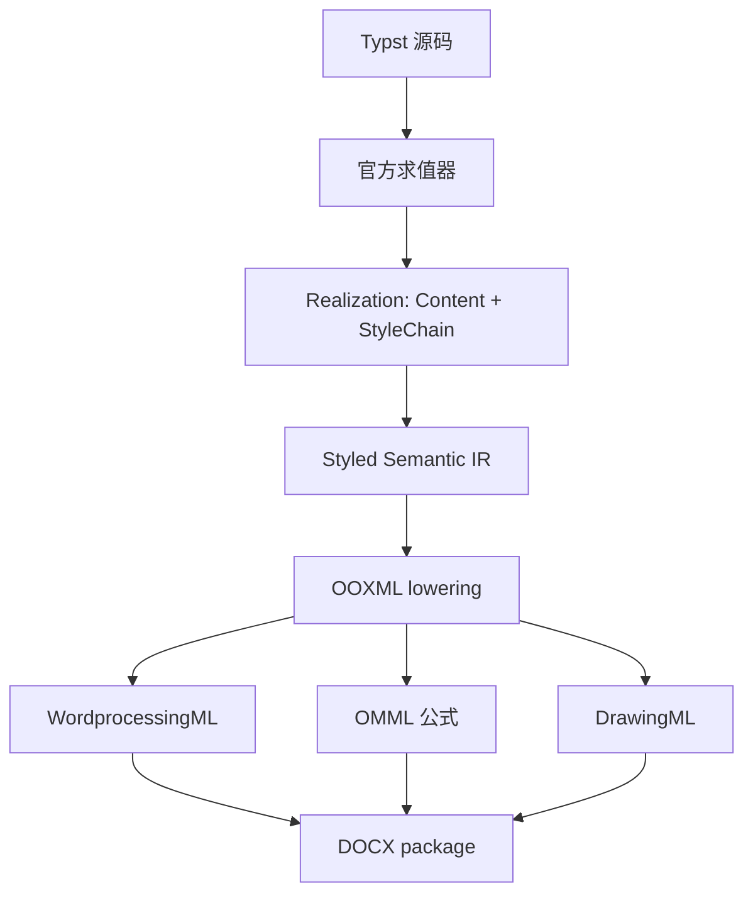

# DOCX 编译后端演进计划

分支：`feature/docx-backend`，基线 main `9f9cb2e`，Typst 0.15.1。
目标：把 typort 从“转换器”演进为真正的 DOCX 编译后端。
权威规则见 `AGENTS.md`；架构现状见 `docs/ARCHITECTURE.md`。本文档只定方向，不复述现状。

## 目标架构

关键变化：转换入口从“HTML + Paged + 源码 AST 三路拼合”提前到 realization 之后。
样式从 `StyleChain` 计算得到，不从渲染后的 glyph 反推；`#align`、`#place`、
`#grid` 等布局内容在 Content 树 walk 里天然有位置，不再事后按几何找回。

## 回退层级

每种 Typst 元素按统一优先级处理，降级必须报告：

A 如 Heading、Footnote、OMML；B 如 grid 转无边框表格；C 如简单 rect、circle、line；
D 如复杂 SVG 绘图；E 为最后手段。

## 步骤

1. **拆分编译与导出**：`convert(world)` 拆为编译与导出两段，导出接受已编译文档，
   不再内部编译；诊断保留 span 信息；写盘原子化。
2. **Styled IR**：以前置 spike 的结论为准，决定两条路之一：上游 typst-html 暴露
   样式信息，或自己走一遍 Content 树（改发 OOXML）。
3. **去掉源码 AST 第三路**：set 规则、分页符、小型大写、悬挂缩进都从 StyleChain 拿。
4. **去掉 recovery/**：布局内容在 Content 树 walk 里直接处理。
5. **Conformance suite + OOXML 加固**：结构、样式、可视三层检查；回退报告；
   严格校验（Word + LibreOffice + python-docx 回读）。

## 本轮之后：对照上游 issue

本轮改造完成后，对照上游 dianzuan/typort 的 open issue 逐项确认：哪些随架构
改进已修复，哪些未修复；未修复的，在架构允许范围内继续修。核查时重新拉
取上游 issue 列表（下面是本轮开始时、2026-11-16 查到的清单）：

- #33 编译错误丢 span、#34 写盘失败留半截文件：步骤 1 已修。
- #35 行断与段断语义、#32 边距 em 值假定 12pt 基准、#31 表格内列表缺 numbering
  引用、#30 脚注与页眉页脚段落丢非文本 inline、#29 未引用中文五级摘要编号
  无条件写出、#28 import 按项目根而非导入文件解析、#27 三个字号探测器
  直方图不一致、#26 等宽/数学字体按名字子串探测、#25 东亚字体/语言按字形
  猜测、#24 高亮色写死黄色、#23 空白 run 被标 smallcaps、#19 四种 inline
  收集模式统一、#20 handle_emphasis_tag 绕过 InlineFmt、#21 preset 脚注
  格式字符串匹配、#22 API 整理。

## 上游现实

Typst 官方 #190（docx 支持）已关闭，docx 不在官方 scope 内；
#9064（序列化 PagedDocument + WASM 插件的自定义后端）还开着。
所以目标不是进上游编译器，而是：typort-core 变成 typst-docx 形态的库，
再接入 tinymist 或 typst-cli 的 fork。

## 工作流

- 每步：实现代理 → 独立测试代理 → review 循环到零 P0/P1 → 提交 → push 请用户评审。
- 纯函数化：新增逻辑优先写成纯函数（显式输入→输出，无隐藏状态、无 I/O），I/O 只放在边界；每个纯函数配单元测试，不只靠 fixture 集成测试。
- 分工文件归属：文档清理只动 `*.md` 的图；spike 只写 `docs/spike-realize.md`；
  步骤 1 只动 `crates/` 与 `tests/`。互不重叠。
- 图一律用 Mermaid，不用 ASCII 图。行文不写测试数量。
