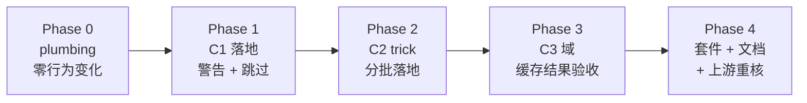

# Typst ↔ OOXML 并集调查与三档兼容模式 C1–C3

日期：2026-11-16。基线：`feature/docx-backend` @ `e6a8b5d`，Typst 0.15.1。
状态：设计文档，不实现。第六批（M1/M2/M8）正在同一工作树内由另一代理实现、
未提交——本文以已提交基线为准，把 M1/M2/M8 当作“进行中、未落地”处理。

## 前置文档

- `docs/conformance-intersection.md`：交集调查（M1–M9 缺口、L1–L6 有损项），
  本文不重复罗列交集，只引用。
- `docs/audit-upstream-issues.md`：17 个上游 issue 的核查。
- `docs/PLAN-docx-backend.md`、`docs/spike-realize.md`、`docs/ARCHITECTURE.md`：
  目标架构（Styled Semantic IR）与三路事实源现状。
- 用户已定的 M9/L2 设计（2026-11-16）：M9 overline 用文字上方插入横线的方式实现
  （Word 插入→形状→直线，Shift 拖水平线，可调颜色/粗细/位置）；L2 标题编号尽力
  用 numbering，Typst 定义了复杂 numbering 时回退到文本。

调查方法：逐项读仓库代码（`crates/typort-core/src/convert/`、
`crates/typort-ooxml/src/`）与 Typst 0.15.1 源码
（`~/.cargo/registry/src/*/typst-library-0.15.1`，下文引用为 `typst-library`；
`typst-html-0.15.1` 同理），对照 conformance fixture
（`tests/fixtures/conformance/`）与 OOXML 结构（ECMA-376 WordprocessingML /
DrawingML / 域代码）。凡标“已核实”的，均有代码或源码位置作证据。

行文不写测试数量。图一律用 Mermaid。

## 1. 三档定义与模式关系

用户已定（本文不改定义，只做落地设计）：

- **C1 最小兼容**：只编译二者的交集，其余一律警告并跳过。
- **C2 图形兼容（默认）**：使用表格、形状等各种 trick，在保证语义优先的基础上
  实现外观一致，尽力支持整个并集。默认编译结果为 C2。
- **C3 动态化兼容**：使用域代码，支持内容的动态化。

### 1.1 模式关系：C3 = C2 + 域

三档是**能力上的严格包含**，不是三套独立实现：


- **C1** 发出交集 I 的原生映射；并集其余部分按 §4 的跳过语义处理，并逐项警告。
- **C2** 在 C1 的基础上，对并集其余部分加图形 trick（§5）。不改变 C1 已有的
  原生映射，只补原来丢弃/失真的部分。
- **C3** 在 C2 的基础上，把“Typst 已算好的值”换成 Word 域代码（§6），使值在
  Word 里可随文档变化而更新。C3 不改任何 trick，只换值的表示形式。

由此得到一条**可检验的不变量**：C3 的输出去掉域代码、只留缓存结果，应当等于
C2 的输出（模去域指令本身）。实现时每个 C3 域都要带缓存结果（§6.3），这条
不变量就是它的验收标准。

### 1.2 两个需要先钉死的区分

**（a）“交集内”的域 vs “动态化”的域。** TOC、PAGE、REF、PAGEREF 这些域本身
就是交集的原生映射（Typst 的 outline、页码、交叉引用 ↔ Word 的同名域），三档
都有，不属于 C3 的增量。C3 的域只覆盖“Typst 已算好、Word 可重算”的值
（§6.1 的判定标准），例如图编号 SEQ、日期 DATE、文内引用 CITATION。

**（b）“跳过”是按方面、不是按元素。** C1 的“跳过”指跳过**不支持的方面**，
不是一律丢弃整个元素（§4.2）。例如 SVG：图片本身在交集中，丢的是“矢量”
这个方面——C1 警告后把图栅格化保留（图片还在），而不是把整张图删掉。
与此相对，纯形状（无文本的 `rect`）没有可保留的方面，整个元素丢弃。
这个解释与用户原话“其余一律警告并跳过”一致：跳过的是“其余”（不支持的
部分），不是整个元素；若用户要的是元素级跳过，§9 的 D8 请改判。

### 1.3 现状相当于哪档

当前转换器最接近 **C1 加栅格化、带一处错配**：M3 浮动内容以纯文本存活、
M4 网格以制表位拼回、M5 形状内文本以纯文本存活——都是 C1 式的“丢方面、
留文本”；L4 的 SVG 栅格化已是 C1 语义下的格式转换；唯一偏离 C1 的是 M9
把 overline 静默改写成 underline（错配，不是降级）。所以**把默认定为 C2
本身不改变现有输出**：C2 的 trick 是逐项落地的，每落地一项都是一次经评审
的行为变化（§7.4）。C1（opt-in）与现状的区别只在两点：每项跳过都有警告，
以及 M9 不再错配成 underline。

## 2. 并集清单

### 2.1 清点口径

并集 = 交集 ∪ Typst-only ∪ OOXML-only。交集见 conformance 文档（22 项，
本文不重复）。本节只列交集**之外**的构造，分三组：

- **M/L 组**：conformance 文档已 catalog 的 15 项，本文只给当前状态（不复述证据）。
- **U 组**：本次调查新增的 Typst-only 构造（27 项），每项给 Typst 侧证据。
- **O 组**：OOXML-only 构造（17 项），分“可达”（C2 trick 载体或 C3 目标）与
  “范围外”（Typst 永远产生不了，转换器不覆盖）。

清点总数：交集 22 + Typst-only 42（M/L 15 + U 27）+ OOXML-only 17 = **81 项**。

本次核查后确认**在交集中**、不列入并集的（核查过程留痕，避免后人重查）：
`ref` 的 supplement 与 form（REF 域 + 补充文本已支持）、标题 hanging-indent
（`w:ind hanging`）、图/表/公式的 supplement 文本（字面文本）、quote 归属
（段落 + 尾段）、`stack`/`pad`/`align`/`h`/`v` 间距（段落/缩进/制表位）。
以下 Typst 机制是编译期行为、不产生输出，也不在并集中：
`layout`/`style`/`measure`、`metadata`/`selector`/`locate`、`sys.inputs`、
`sys.version`、`random`、数据加载（`csv`/`json`/`yaml`/`toml`/`xml`/`read`/
`plugin`）、`show` 规则本身（见 U27）。

### 2.2 M/L 组：当前状态

| 编号 | 构造 | 状态（2026-11-16） |
| --- | --- | --- |
| M1 | enum 编号样式（`"a)"`、`"i."`、`"1.1"`） | 进行中（第六批，未落地） |
| M2 | 单元格背景（`table(fill:)`） | 进行中（第六批，未落地） |
| M3 | 浮动图形（`#place(..., float: true)`） | 未修 |
| M4 | 网格布局（`#grid`） | 未修（现为制表位恢复） |
| M5 | 图形与简单形状（`rect`/`line`/`circle` 等） | 未修（形状丢弃，内文以纯文本存活） |
| M6 | 分节（栏数/边距变化） | 未修（只检测页尺寸变化） |
| M7 | 首页不同 / 奇偶页不同页眉页脚 | 未修（IR 只有一对 header/footer） |
| M8 | 页码交叉引用（PAGEREF） | 进行中（第六批，未落地） |
| M9 | 上划线（`#overline`） | 已定设计（第七批）：文字上方插横线形状 |
| L1 | 嵌套列表级定义 | 已修复（batch 1） |
| L2 | 标题编号 | 已定设计（第七批）：尽力用 numbering，复杂回退文本 |
| L3 | 页眉页脚格式 | 未修 |
| L4 | 矢量图（SVG、GIF/WebP、绘图画布） | 部分（栅格化回退已存在，矢量未保留） |
| L5 | 高亮颜色 | 已修复（batch 2） |
| L6 | 文内引用（`@key`） | 已定：C2 默认出字面标记 + 内部超链接，不发 CITATION 域；C3 是否发域见 §9 D2 |

### 2.3 U 组：新增的 Typst-only 构造

| 编号 | 构造 | Typst 侧证据 | OOXML 现状 |
| --- | --- | --- | --- |
| U1 | `#place` 非浮动绝对定位（dx/dy/对齐/跨栏） | `PlaceElem`（`layout/place.rs`：alignment、scope、float、clearance；`dy: 2pt` 用例） | 无流式等价物；`convert/` 无 `PlaceElem` 处理 |
| U2 | 变换：`move` / `rotate` / `scale` | `MoveElem{dx,dy}`、`RotateElem{angle,origin,reflow}`、`ScaleElem{factor,x,y,origin,reflow}`（`layout/transform.rs`） | 无 WML 等价物；只有形状旋转（`a:bodyPr rot`）与字号缩放 |
| U3 | `box` / `block` 的 fill/stroke/radius/clip | `BoxElem`、`BlockElem`（`layout/container.rs`：fill、stroke、radius、inset、outset、clip） | 无段落级圆角/裁剪；单格表可代 fill/stroke/inset，radius 无解 |
| U4 | 表格 gutter / stroke / inset | `TableElem`（`model/table.rs`：gutter、column/row_gutter、stroke、inset） | `w:tblCellMar`、`w:tblCellSpacing`、`w:tblBorders` 可代；gutter 本身无直接对应 |
| U5 | `figure` 的 placement / scope | `FigureElem`（`model/figure.rs`：placement、scope、counter、kind） | 图注编号见 §6 SEQ；placement 无流式等价物 |
| U6 | `outline` 的自定义 target / indent | `OutlineElem`（`model/outline.rs`：title、target、depth、indent） | TOC 域只覆盖“标题目录”；自定义 target 无对应 |
| U7 | `raw` 代码块的语法着色 | `RawElem`（`text/raw.rs`：theme、syntaxes；无行号字段——行号不是核心 Typst 功能） | CodeBlock 样式已存在；token 级颜色现无映射 |
| U8 | `par` 的 linebreaks / justification-limits | `ParElem`（`model/par.rs`：linebreaks、justification_limits、leading、spacing、justify） | Word 自行断行；断行策略无 OOXML 对应 |
| U9 | 文本度量：tracking / spacing / cjk-latin-spacing / baseline / overhang / top-edge / bottom-edge | `TextElem`（`text/mod.rs`：tracking、spacing、cjk_latin_spacing、baseline、overhang、top_edge、bottom_edge） | tracking→`w:spacing`、baseline→`w:position`；其余无对应 |
| U10 | 文本 OpenType 特性：kerning / ligatures / number form-width / stylistic sets / alternates / slashed zero / fractions / variations | `TextElem`（`text/mod.rs`：kerning、ligatures、discretionary/historical_ligatures、number_type、number_width、slashed_zero、fractions、features、variations、stylistic_set、alternates） | 部分有：`w:kern`、`w:ligatures`、`w:numForm`、`w:numSpacing`、`w:stylisticSets`、`w:cntxtAlts`；slashed zero / fractions / variations 无对应 |
| U11 | 文本描边 `text(stroke:)` | `TextElem.stroke: Option<Stroke>` | `w:outline` 效果只有开关、无颜色；描边颜色无对应 |
| U12 | `underline` 的 stroke / offset / evade / background | `UnderlineElem`（`text/deco.rs`：stroke、offset、extent、evade、background；同文件 `OverlineElem` 亦然） | `w:u` 只有线型 + 颜色；offset / evade / background 无对应 |
| U13 | `page` 的 fill / background / foreground / binding / flipped / bleed | `PageElem`（`layout/page.rs`：fill、background、foreground、binding、flipped、bleed、margin、paper、columns） | fill→`w:background`、binding→`w:mirrorMargins`+`w:gutter`、flipped→`w:pgSz orient`；background/foreground 内容无页级容器；bleed 无对应 |
| U14 | 分栏 gutter / 分隔线 | `PageElem.columns` + `grid` 栏参数；Typst 栏间距是布局量 | `w:cols w:space`、`w:cols w:sep` 可代 |
| U15 | 计数器显示：`counter(page/heading/figure/equation/footnote).display()` 与 `.at()` | `Counter`（`introspection/counter.rs`：`display`、`display_at`、`at`、`get`、`update`） | C2 字面值；C3 见 §6（PAGE / PAGEREF / REF / SEQ） |
| U16 | 动态内容：`state` / `query` / `context` 的求值结果 | Typst 内省 API（`state`、`query`、`context`）；编译期求值，输出时已是定值 | 除页眉 STYLEREF（§6）外无重算可能 |
| U17 | `datetime.today()` 与自定义显示 | Typst 标准库 `datetime`；`display()` 格式串 | C2 字面日期；C3 DATE 域 |
| U18 | `cite` 的 form / style / supplement | `CiteElem`（`model/cite.rs`：key、supplement、form、style、lang、region） | C2 字面标记 + 内部超链接（L6 定论）；C3 CITATION 域（§9 D2） |
| U19 | `image` 的 fit / alt | `ImageElem`（`visualize/image/mod.rs`：fit、format、alt、width、height、scaling） | fit→`a:srcRect` 裁剪；alt→`wp:docPr descr`（writer 已有 `wp:docPr`，未填 descr）；format 见 L4 |
| U20 | 公式编号：`equation(numbering:)` | `EquationElem`（`math/equation.rs`：numbering、number_align） | C2 字面编号（现状：制表位对齐）；C3 SEQ |
| U21 | `html.elem` / `html.frame`（HTML 目标分支内容） | `HtmlElem`（`typst-html`：`handle_html_elem`、`HtmlElem`）；spike 已记：模板的 `target() == "html"` 分支内容 | 无 OOXML 等价物 |
| U22 | 表格摘要 `table(summary:)` | `TableElem.summary: Option<EcoString>` | `w:tblCaption` + `w:tblDescription`（tblPr，无障碍摘要） |
| U23 | 文本 costs：断字/孤行/寡行控制 | `TextElem.costs: Costs`（断字、孤行、寡行代价） | `w:widowControl`、`w:keepLines`、`w:keepNext` 部分可代 |
| U24 | `list` 自定义 marker | `ListElem.marker: ListMarker`（`model/list.rs`） | `w:lvlText` 字面 marker |
| U25 | `enum` 的 `reversed: true` | `EnumElem.reversed`（`model/enum.rs`） | OOXML 编号无倒序；只能字面化 |
| U26 | `footnote` 自定义编号 | `FootnoteElem.numbering: Numbering`（`model/footnote.rs`） | `w:footnotePr w:numFmt` 可代格式；函数式编号回退字面 |
| U27 | 改变语义的 `show` 规则 | spike 已记：heading 可被 show 成普通文本加图形；IR 须同时记原始身份与实现后结构 | 架构级问题，不是模式级问题；三档都不改变它，留给步骤 2 的 IR 设计 |

### 2.4 O 组：OOXML-only 构造

| 编号 | 构造 | Typst 能否产生 | 转换相关性 |
| --- | --- | --- | --- |
| O1 | 批注（`w:comment`） | 否 | 范围外 |
| O2 | 修订（`w:ins`/`w:del`/`w:moveFrom`/`w:moveTo`） | 否 | 范围外 |
| O3 | 内容控件 SDT（除 BIBLIOGRAPHY 外） | 否 | 范围外 |
| O4 | 邮件合并域（MERGEFIELD、ASK、FILLIN 等） | 否 | 范围外 |
| O5 | 图表、OLE 对象、SmartArt、WordArt | 否 | 范围外 |
| O6 | 尾注（`w:endnoteReference`，区别于脚注） | 否（Typst 只有脚注） | 范围外 |
| O7 | 文本效果 `w:vanish` / `w:webHidden` / `w:specVanish` / `w:shadow` / `w:emboss` / `w:imprint` | 否（`hide` 是不输出，不是隐藏文本；`w:outline` 见 U11） | 范围外 |
| O8 | 首字下沉（`w:framePr dropCap`） | 否 | 范围外 |
| O9 | 浮动表格 / 框架（`w:tblpPr`、`w:framePr`） | 间接 | C2 trick 载体（浮动定位） |
| O10 | 行号（`w:lnNumType`，节级） | 间接 | C2 trick 载体（代码行号，见 §5） |
| O11 | `w:docGrid` / `w:kinsoku` / `w:overflowPunct`（CJK 版式） | 否 | 范围外 |
| O12 | `w:proofErr` / `w:rsid`（Word 内部） | 否 | 范围外 |
| O13 | 主题 / 潜在样式（latent styles） | 否 | 范围外（writer 发 styles.xml，但只写用到的样式） |
| O14 | 文档属性域（DOCPROPERTY、FILENAME、FILESIZE、NUMCHARS、NUMWORDS、EDITTIME、AUTHOR、TITLE、REVNUM、TEMPLATE、USERNAME、SAVEDATE、PRINTDATE、CREATEDATE、INFO） | 否 | 范围外；DOCPROPERTY 显 `document(title:)` 记为可选（§6.5） |
| O15 | 索引/引文目录域（TC、XE、TA、TOA） | 否 | 范围外 |
| O16 | GOTOBUTTON / MACROBUTTON / FORMTEXT / QUOTE / SET / INCLUDETEXT / INCLUDEPICTURE / LINK | 否 | 范围外；特别说明：SET 不是 `state` 的映射——Typst 的 `state` 值是编译期算出的定值，Word 的 SET 域无法重算它（§6.5） |
| O17 | C3 目标域组：SEQ、STYLEREF、LISTNUM、NOTEREF、NUMPAGES、SECTION、SECTIONPAGES、DATE、TIME、CITATION | 间接（经 Typst 计数器/日期/引用） | C3 用，详见 §6 |

## 3. 覆盖矩阵

并集里每个 Typst-only 构造在三档下的待遇。交集构造见 conformance 文档，
三档一致（原生映射）；OOXML-only 的可达项（O9/O10/O17）列在表后。
“警告+跳过”按 §4 的语义；“trick”按 §5；“域”按 §6。

| 构造 | C1 最小兼容 | C2 图形兼容（默认） | C3 动态化 |
| --- | --- | --- | --- |
| M1 enum 编号样式 | 警告 + 退回 decimal（§4.2 S4） | numFmt + lvlText 映射（第六批进行中） | 同 C2 |
| M2 单元格背景 | 警告 + 不写 `w:shd` | `w:shd`（第六批进行中） | 同 C2 |
| M3 浮动图形 | 警告 + 内容以流式段落保留，丢定位（S2） | `wp:anchor` 浮动；图直接锚定，文本进 `wps:txbx` | 同 C2 |
| M4 网格布局 | 警告 + 单元格文本以段落顺序保留（S2，现制表位恢复属此列） | 无边框表（列宽取 track sizing） | 同 C2 |
| M5 图形与简单形状 | 警告 + 内文以流式段落保留，纯形状丢弃（S2/S3） | 简单形状 → DrawingML 原生形状；复杂路径 → `a:custGeom`；CeTZ 画布 → 栅格化 | 同 C2 |
| M6 分节（栏数/边距变化） | 警告 + 不分节（单 sectPr，现状） | 栏数/边距变化产出 Continuous/NextPage/EvenPage/OddPage | 同 C2 |
| M7 首页/奇偶页眉页脚 | 警告 + 只留默认页眉页脚 | `w:titlePg` + `w:evenAndOddHeaders`，三套 part | 同 C2 |
| M8 页码交叉引用 | PAGEREF（交集域，三档都有；第六批进行中） | 同 C1 | 同 C1 |
| M9 上划线 | 警告 + 保留纯文本，不写 underline（修正现状错配） | 文字上方插横线形状（第七批，用户已定） | 同 C2 |
| L1 嵌套列表级定义 | 已修复（三档一致） | 同 C1 | 同 C1 |
| L2 标题编号 | 字面文本（现状） | 编号可表示时接 numbering；复杂时回退字面文本（第七批，用户已定） | 同 C2（LISTNUM 仅用于行内计数器显示，见 §6） |
| L3 页眉页脚格式 | 警告 + 纯文本段落（现状） | 边区提取保留 run 样式，多行分段 | 同 C2 |
| L4 矢量图 | 警告（丢矢量）+ 栅格化保留图片 | SVG part + PNG 回退（`mc:AlternateContent`）；GIF/WebP 仍转 PNG | 同 C2 |
| L5 高亮颜色 | 已修复（三档一致） | 同 C1 | 同 C1 |
| L6 文内引用 | 字面标记 + 内部超链接（定论） | 同 C1 | CITATION 域（§9 D2 待确认） |
| U1 place 绝对定位 | 警告 + 内容流式保留，丢定位（S2） | `wp:anchor`（位置取自 Paged 几何） | 同 C2 |
| U2 move/rotate/scale | 警告 + 内容流式保留，丢变换（S2） | rotate → 形状旋转（`a:bodyPr rot`）；scale 文本 → 字号缩放；move → 锚定偏移 | 同 C2 |
| U3 box/block fill/stroke/radius/clip | 警告 + 内容流式保留，丢装饰（S1） | radius=0 → 单格表（`w:shd`+`w:tcBorders`+`w:tcMar`）；radius≠0 → 形状；clip 丢弃并警告 | 同 C2 |
| U4 表格 gutter/stroke/inset | 警告 + 丢 gutter，stroke/inset 按现状 | gutter → `w:tblCellMar`/`w:tblCellSpacing`；stroke → `w:tblBorders` | 同 C2 |
| U5 figure placement/scope | 警告 + 图按流式位置保留，丢 placement | placement → 锚定（同 M3）；scope 跨栏 → 分节处理（同 M6） | 图编号 → SEQ（§6） |
| U6 outline 自定义 target/indent | 警告 + 自定义 target 跳过，只留标题目录（TOC 域是交集） | TOC 域加开关（深度/缩进）；自定义 target 仍跳过并警告（documented gap） | 同 C2 |
| U7 raw 语法着色 | 警告 + 纯文本代码块（现状 CodeBlock 样式） | token 颜色待探针（§5.8，须先核实 Paged 能否按 token 取色） | 同 C2 |
| U8 par linebreaks/justification-limits | 静默跳过（无警告：Word 自行断行，无视觉差异） | 同 C1 | 同 C1 |
| U9 文本度量 | tracking→`w:spacing`、baseline→`w:position`（交集内）；其余警告 + 跳过 | 同 C1 | 同 C1 |
| U10 OpenType 特性 | 有映射的写出（`w:kern`/`w:ligatures`/`w:numForm`/`w:numSpacing`/`w:stylisticSets`/`w:cntxtAlts`）；其余警告 + 跳过 | 同 C1 | 同 C1 |
| U11 文本描边 | 警告 + 跳过描边 | `w:outline` 效果，颜色丢失并警告 | 同 C2 |
| U12 underline stroke/offset/evade/background | 警告 + 只留 `w:u` 线型与颜色 | 同 C1（offset/evade/background 无 OOXML 对应，documented gap） | 同 C1 |
| U13 page fill/background/foreground/binding/flipped/bleed | fill→`w:background`、binding→`w:mirrorMargins`+`w:gutter`、flipped→横向（交集内）；background/foreground 内容警告 + 跳过；bleed 静默跳过 | background/foreground 内容 → 页眉 part 内锚定形状（水印式）；其余同 C1 | 同 C2 |
| U14 分栏 gutter/分隔线 | `w:cols w:space`/`w:sep`（交集内） | 同 C1 | 同 C1 |
| U15 计数器显示 | 字面值（现状） | 同 C1 | PAGE / PAGEREF / REF / SEQ / NUMPAGES（§6） |
| U16 state/query/context | 字面值（编译期已求值） | 同 C1 | 页眉内 query → STYLEREF；其余字面值 |
| U17 datetime.today() | 字面日期 | 同 C1 | DATE / TIME 域 |
| U18 cite form/style/supplement | 字面标记 + 内部超链接（L6 定论） | 同 C1 | CITATION 域（§9 D2 待确认） |
| U19 image fit/alt | 警告 + 按现状尺寸嵌入，丢 fit/alt | fit→`a:srcRect` 裁剪；alt→`wp:docPr descr` | 同 C2 |
| U20 公式编号 | 字面编号（现状：制表位对齐） | 同 C1 | SEQ（`SEQ Equation`） |
| U21 html.elem/html.frame | 警告 + elem 留内文、frame 跳过（S2/S3） | elem 留内文；frame 栅格化为图 | 同 C2 |
| U22 表格摘要 | 警告 + 跳过摘要 | `w:tblCaption` + `w:tblDescription` | 同 C2 |
| U23 文本 costs | 静默跳过（Word 的孤行控制是文档级开关，效果等价） | 标题加 `w:keepNext`（§5.7）；其余同 C1 | 同 C2 |
| U24 list 自定义 marker | 警告 + 退回 bullet（S4） | `w:lvlText` 字面 marker | 同 C2 |
| U25 enum reversed | 警告 + 退回正序 decimal（S4） | 数字字面化（外观一致，自动编号丢失，documented gap） | 同 C2 |
| U26 footnote 自定义编号 | 格式可映射时写 `w:footnotePr w:numFmt`；函数式警告 + 退回 decimal | 同 C1 | 同 C1 |
| U27 show 规则改语义 | 不变（架构级，见 §2.3） | 同 C1 | 同 C1 |

OOXML-only 可达项在三档下的待遇：

| 构造 | C1 | C2 | C3 |
| --- | --- | --- | --- |
| O9 浮动表格/框架（`w:tblpPr`、`w:framePr`） | 不用 | 浮动定位的载体（M3/U1/U5 的实现手段） | 同 C2 |
| O10 行号（`w:lnNumType`） | 不用 | 代码块行号的载体之一（§5.8；逐块行号优先用表 trick） | 同 C2 |
| O17 C3 目标域组 | 只用交集内的域（TOC/PAGE/REF/PAGEREF） | 同 C1 | 全部启用（§6） |

其余 O 组（O1–O8、O11–O16）三档都不覆盖：Typst 永远产生不了，转换器不发射。

## 4. C1：警告与跳过语义

### 4.1 警告通道

警告与编译错误是两类东西，不走同一通道：

| | 编译错误 | C1 警告（降级报告） |
| --- | --- | --- |
| 产生时机 | Typst 编译失败 | 编译成功、转换时某方面被跳过 |
| 类型 | `Vec<SourceDiagnostic>`（步骤 1 已有） | 新增 `Vec<Degradation>`（见下） |
| CLI 表现 | stderr 打印，exit 1 | stderr 打印，exit 0（成功仍是成功） |
| 是否进 docx | 否（无输出） | 否（输出保持干净；sidecar 见下） |

建议的 API 形态（实现时定，本文只定方向）：

```mermaid
flowchart LR
    SRC[Typst 源码] --> CONV[convert / export<br/>+ ConvertOptions{compat}]
    CONV --> OUT[ConvertOutcome<br/>document + degradations]
    OUT --> CLI[CLI：stderr 打印警告<br/>+ 可选 sidecar 报告]
    OUT --> LIB[库调用方：自行处理 degradations]
```

- 新增 `typort_core::Degradation { span: Option<Span>, construct: &'static str, action: DegradationAction, message: String }`，其中 `action` 取 `Skipped`（方面丢弃）/`Approximated`（近似保留，如栅格化）/`Literalized`（字面化，如编号退回 decimal）。span 优先取元素在源码中的位置，渲染复用步骤 1 的 `diag::format_diagnostic`（`file:line:col: message` 形态）；无 span 的降级（如 recovery 层发现的）带页码提示，不伪造 span。
- `convert(world, &ConvertOptions) -> Result<ConvertOutcome, Vec<SourceDiagnostic>>`，`export(...)` 同理。`ConvertOptions { compat: CompatMode }`（§7）。这是对 typort-core 两个公开入口的 breaking 改动，调用点（CLI、测试）随之迁移，属机械改动。
- CLI 在写盘成功后把警告打到 stderr，格式与编译诊断一致（`warning: file:line:col: <construct>: <message>`），随后仍打印 `wrote <path>`。可选 `--degradation-report <path>` 写一份 sidecar 报告（JSON，供机器消费；内容与 stderr 相同），默认不写——docx 本身不内嵌报告。
- 去重与上限：同一（construct，span）只报一次；无 span 的同类警告只报首次出现并附计数（“…及同类 N 项”）；总打印数设上限并在末尾汇总。理由：500 页文档里的 500 个浮动图形不应刷爆 stderr。去重策略本身是 §9 D7 的确认点。

### 4.2 跳过语义：五类（S1–S5）

“跳过”按方面分五类，每类在矩阵里已标出。共同原则：**C1 永不静默丢文本**；
丢的只能是方面（样式、定位、格式），纯形状等无文本元素除外。

| 类 | 含义 | 例子 |
| --- | --- | --- |
| S1 丢属性、留文本 | 元素与文本都在，只丢不支持的样式方面 | overline 只留文本（不写 underline）；单元格 fill 不写；文本描边丢弃 |
| S2 丢定位/结构、留文本流 | 内容按文档顺序以普通段落保留，丢位置与容器结构 | 浮动图形、绝对定位、网格、形状内文本 |
| S3 丢整个元素 | 元素无文本可留，整体丢弃 | 无文本的纯形状、纯线条、`html.frame` |
| S4 退回字面/默认 | 编号类退回可表示的近似值 | enum 编号退回 decimal；自定义 list marker 退回 bullet；倒序 enum 退回正序 |
| S5 丢动态、留静态 | 动态值只留编译期算出的字面结果 | 计数器显示、日期、state/query 结果（C3 才变域） |

S5 与“警告”的关系：C1 不对“失去动态性”警告——C1 的定义里动态性本来就不
在交集内，警告只针对被丢弃的方面。字面值本身是正确的，Word 打开即见正确
文本，只是之后不随文档变化。这是 C1 与 C3 的分工，不是缺陷。

### 4.3 跳过后文档结构仍合法

跳过在 IR 层发生，绝不在 writer 层把半个节点写出去：

- 被跳过的元素不进入 IR；引用它的结构同步降级（例如某 label 的目标元素被
  S3 丢弃，指向它的 `ref` 在同一遍里退回字面文本，不留悬空书签）。
- writer 已有的不变量不受影响：`numbering.xml` 只在有列表时写出
  （`RelKind::Numbering` 门控）、`footnotes.xml.rels` 只在有脚注图时写出等；
  C1 不新增 part、不新增关系，只减少内容。
- 空段落清理：S2/S3 可能留下空段落（例如只含一个被丢形状的段落），由现有的
  coalesce/postprocess 负责合并或清除，不单独为 C1 加清理逻辑。

## 5. C2：trick 清单

总规则（用户原话“语义优先”的落地定义）：

1. **不降级已有语义**：标题仍是 Heading 样式、列表仍是 `w:numPr`、文本仍是
   可搜索的 run。trick 只包住真实内容，不替代它。
2. **trick 是加法**：去掉 trick（形状、锚定、单格表）后剩下的仍是合法内容，
   不是空壳。
3. **不伪造语义**：不造假标题、假编号（字面数字是文本，不是 `w:numPr`）。
4. **trick 失败时退回 C1**：量不到宽度、算不出位置时，警告 + 按 C1 处理，
   绝不发一个错位的 trick（错位比缺失更坏）。

### 5.1 M9 overline：文字上方插横线形状（用户已定）

用户定的做法是 Word 里的手工操作（插入→形状→直线，Shift 拖水平线，可调
颜色/粗细/位置）。OOXML 编码：

- 每个被 overline 的 run，在同一段落内加一个锚定线形状：
  `w:drawing` → `wp:anchor`（`relativeFrom="paragraph"` 横向、
  `relativeFrom="line"` 纵向，`behindDoc="0"`）→ `wps:wsp` →
  `a:prstGeom prst="line"` + `a:ln`（颜色/粗细取 `OverlineElem.stroke`）。
- 线宽 = 该 run 的渲染宽度 + `extent`（两侧外延）；线纵向位置由
  `OverlineElem.offset`（或字体表的 overline 位置）决定。宽度与位置取自
  Paged 渲染（与图片显示尺寸同路：按内容哈希/span 匹配 run 的几何）。
- `evade: true`（默认）时线在与字形碰撞处断开——形状层面无法逐字断开，
  实现时整条线照画并在文档里记为已知近似；`background: true/false`
  只影响层叠（线在字前/字后），锚定形状的 `behindDoc` 对应之。
- 已知局限（不是待定项，是该做法的固有代价，写进文档即可）：Word 重排后
  线不跟随文本走（位置是转换时定死的）；跨行文本每行各需一条线（按 Paged
  的可视行拆分）。被否决的替代方案：EQ 域 `\o` 上下叠印（用下划线字符叠
  在文本上）——跟随重排，但依赖字体且线型不可控；`w:pBdr` 段落顶框——只
  对整段 overline 有效。两者都不如用户定的形状做法。

### 5.2 M3/U1/U5 浮动与绝对定位：`wp:anchor`

- 图：`wp:anchor` 直接锚定图片（现状只有 `wp:inline`，writer 需加 anchor
  分支）。位置取自 Paged 几何（页内绝对坐标 → `relativeFrom="page"` 是最
  简单且最保真的取法）；环绕按 float 的 top/bottom 取 `wrapTopAndBottom`，
  其余取 `wrapSquare`；`clearance` → anchor 的 `distT/distB`。
- 文本：锚定形状内的 `wps:txbx` + `w:txbxContent`，里面放真实段落与 run
  （仍是可编辑文本，不是图片）。
- `#place` 的 `scope: "parent"`（跨栏浮动）需配合 M6 的分节：锚定在父容器
  对应的节内，否则位置无从谈起。
- 语义：浮动内容在文档流中的逻辑位置不变（读屏按逻辑顺序读，Typst 的
  `PlaceElem` 文档亦然：辅助技术按逻辑位置读，与物理位置无关）。

### 5.3 M4 网格：无边框表

- `#grid` → `w:tbl`（无边框、`w:tblLayout fixed`），列宽取 track sizing
  （复用 `table_width.rs` 的 fr/rel/auto 换算逻辑），单元格按文档顺序填入，
  嵌套 grid → 嵌套表。
- 边框（用户定，2026-11-16）：grid 默认无边框，转换出的表必须默认边框无颜色。
  关键点：writer 恒发 `w:tblBorders`，`borders: None` 时回退到 0.5pt 全格线——
  留空等于有边框。所以 grid 转换必须显式置 `borders = Some(TableBorders::default())`
  （六边全 `w:val="nil"`），不能留 None。grid 带 `stroke` 时才按 stroke 映射单线边框。
- 语义说明（诚实项）：grid 是布局，表也是布局，但 Word 会把表当作表结构；
  这是一次**表示层面的平移**，不是语义提升。缓解：无表头行、无边框、
  不写 `w:tblHeader`，并在文档里记为已知平移。替代方案（制表位拼回）是
  现状的 C1 行为，丢失对齐精度，故 C2 选表。

### 5.4 M5 形状：DrawingML 原生形状

- `rect`/`circle`（`ellipse`）/`line` → `wps:wsp` + `a:prstGeom`
 （`rect`/`ellipse`/`line`，圆角矩形取 `roundRect` + `adj`），`a:solidFill`/
  `a:ln` 取 fill/stroke，形状内文本进 `wps:txbx`（真实 run）。
- `polygon` → `a:custGeom` + `a:path`（`moveTo`/`lnTo`/`close`）；
  `curve` → `a:custGeom` + `a:cubicBezTo`（OOXML 支持三次贝塞尔）。
- CeTZ 等绘图画布整体栅格化（D 级回退，现状已有 `rasterize_frame` 路径）：
  画布是任意绘图程序的输出，逐元素转 DML 不划算。
- 位置与尺寸取自 Paged 几何；形状在流中的锚点放在其逻辑位置的段落内。

### 5.5 L4 矢量图：SVG part + PNG 回退

- SVG：写出原生 SVG part（`word/media/*.svg`），drawing 里用
  `mc:AlternateContent` 包两层——首选 `a:blip` + SVG 扩展
  （`{96DAC541-7B7A-43D3-8B79-37D633B846F1}`），回退为现有 resvg 栅格化
  的 PNG。Word（2016+）与 LibreOffice 读 SVG；旧 Word 读 PNG 回退。
- GIF/WebP：仍转 PNG（Word 无原生动画支持，documented gap）。
- 栅格化分辨率：回退 PNG 至少 2x，避免打印模糊（现状 resvg 1x，见
  conformance 文档 L4 行）。

### 5.6 M6/M7：分节与多套页眉页脚

- M6：`detect_section_breaks` 除页尺寸外再比较栏数与边距（栏数/边距取自
  源码 AST 的 `#set page`，按页归属）；产出 `SectionBreakType` 已有的
  Continuous/NextPage/EvenPage/OddPage（IR 已有，convert 从未构造）。
- M7：IR 的 `Document` 由一对 header/footer 扩展为三套（default/first/
  even），writer 发 `w:titlePg` + `w:evenAndOddHeaders` +
  `w:headerReference w:type="first|even|default"`；边区提取除首页外再读
  奇偶页边区。
- 依赖：M6 的栏数/边距按页归属需要源码 AST 与 Paged 页的对应，步骤 2 的
  styled IR 会让这件事变直接；步骤 2 之前可用现有 Paged + AST 拼合做，
  成本较高（§8 排在 2b）。

### 5.7 L3 与其他页眉页脚 / 文本小项

- L3：边区提取保留每片段的 run 样式（字体/字号/颜色/粗体）与多行分段，
  writer 的 header/footer 段落按普通段落写 run（现状两层都只认文本）。
- U23：标题段加 `w:keepNext`（标题与下段粘连，Typst 的 sticky 语义；
  现状 styles.rs 注释明确写着“No w:keepNext”——C2 把它加上）。
- U13：`page(background:)` / `foreground:` 内容 → 页眉 part 内锚定形状
  （水印式做法：每页重复的背景/前景内容只能放在 header part 里，这是
  Word 的模型）；`page(fill:)` → `w:background`。
- U14：分栏 gutter → `w:cols w:space`，分隔线 → `w:cols w:sep="1"`。
- U22：`table(summary:)` → `w:tblCaption` + `w:tblDescription`。
- U19：图片 alt → `wp:docPr descr`（writer 已有 `wp:docPr`，只差填 descr）；
  fit → `a:srcRect` 裁剪。
- U9/U10：tracking → `w:spacing`（字符间距，1/20pt）；baseline →
  `w:position`（升降，半磅）；kerning → `w:kern`；ligatures →
  `w:ligatures`；number form/width → `w:numForm`/`w:numSpacing`；
  stylistic sets → `w:stylisticSets`；alternates → `w:cntxtAlts`
  （各值映射细节实现时按 ECMA-376 核对）。
- U24：list 自定义 marker → `w:lvlText` 字面 marker。
- U3：`box`/`block` radius=0 → 单格表（`w:shd` + `w:tcBorders` +
  `w:tcMar` 承 inset）；radius≠0 → 形状（§5.4）；clip 丢弃并警告
  （Word 无裁剪容器等价物）。
- U2：rotate → 形状旋转（`a:bodyPr rot`，`reflow: false` 的原地旋转正好
  对应形状旋转；`reflow: true` 的重排旋转只做近似并警告）；scale 文本 →
  字号缩放；move → 锚定偏移（同 §5.2）。
- U4：表格 gutter → `w:tblCellMar` / `w:tblCellSpacing`；stroke →
  `w:tblBorders`。
- U6：outline 的 indent → TOC 域开关（`\t` 制表位样式）；自定义 target
  仍跳过并警告（documented gap，TOC 域表达不了任意 target）。
- U25：倒序 enum → 数字字面化（外观一致，自动编号丢失，documented gap）。

### 5.8 待探针：U7 raw 语法着色

`raw` 块的 token 颜色是否可取，须先做探针再定 trick：Paged 的 run 是否按
token 带颜色（`run_style.rs` 的 per-run 样式路径是否覆盖代码块 token）。
若可取，C2 按 token 写颜色；若不可取，C2 与 C1 同（纯文本代码块），记为
documented gap。探针本身是一次小调查，不属实现。

### 5.9 L2 标题编号的“可表示”边界（第七批，用户已定方向）

用户已定：尽力用 numbering，复杂回退文本。边界定义如下（实现时按此执行，
§9 D10 请用户确认边界本身）：

- `Numbering::Pattern` 且全部 counting symbol 可映射 → 接 numbering：
  标题段写 `w:numPr`（按级别取 numId），`w:lvl` 的 `numFmt`/`lvlText`
  由模式生成；多级模式（`"1.1"`、`full: true`）生成多级 abstractNum，
  `lvlText` 用 `%1.%2` 形式。
- `Numbering::Func`（任意函数）→ 回退字面文本（现状行为）。
- 模式含不可映射 symbol → 回退字面文本。

Counting symbol → `w:numFmt` 映射（实现时按 ECMA-376 `ST_NumberFormat`
逐项核对，带“（核）”的须核对后再写死）：

| Typst symbol | `w:numFmt` |
| --- | --- |
| `1` | `decimal` |
| `a` / `A` | `lowerLetter` / `upperLetter` |
| `i` / `I` | `lowerRoman` / `upperRoman` |
| `一` | `chineseCounting`（核） |
| `壹` | `chineseLegalSimplified`（核） |
| `あ` / `ア` | `aiueo` / `aiueoFullWidth`（核） |
| `い` / `イ` | `iroha` / `irohaFullWidth`（核） |
| `א` | `hebrew1`（核） |
| `가` | `koreanCounting`（核） |
| `१` | `hindiNumbers`（核） |
| `①` | `decimalEnclosedCircle`（核） |
| `α`、`Α`、`ㄱ`、`*`、`١`、`۱`、`১`、`ক`、`⓵` | 无对应 → 回退字面文本 |

前缀/后缀按字面进 `w:lvlText`（`%N` 占位 + 原样文本）。同一规则也适用
于 M1 的 enum 编号（两者共用 `Numbering` 类型）。

### 5.10 SVG 兜底：C2 trick 梯子的最后一档（用户定，2026-11-16）

- 规则：C2 的每个 trick 都有原生编码优先；原生编码不存在或做不出来时，
  最后一档是把该构造渲染成 SVG 原生嵌入（§5.5 的 SVG part + PNG 回退），
  而不是回退到 C1 的警告 + 跳过。SVG 兜底只在“实在无法用内置形状等方法
  表示”时启用，不得在有原生编码时图省事用 SVG 代替。
- 适用：M5 复杂路径 / CeTZ 画布（§5.4 的 custGeom 做不出时）、U2 变换
  （rotate/scale/move 的组合效果）、U3 clip、以及任何未 catalog 的新构造。
  矩阵里各行的 C2 列不变，SVG 兜底是各行共用的最后一档。
- 代价（必须写进文档与警告）：SVG 里的文本不在 Word 文本层——不可检索、
  不参与 Word 重排与拼写检查、翻译与无障碍工具看不到；打印与缩放无损，
  但可编辑性低于原生编码。每次启用都要发一条 Degradation（action:
  Approximated，注明原生编码缺失的原因）。
- 前置工作：需要一条“把任意构造渲染成 SVG”的路径（Typst 自身可出 SVG，
  但 typort 现在一次编译只出 HTML + Paged；单元素 SVG 渲染是新能力，
  见 §8 Phase 2d）。在此之前 SVG 兜底不可用，各行仍按原 trick 或 C1 回退。

## 6. C3：域代码清单与模式关系

### 6.1 什么进 C3：判定标准

进 C3 的域必须同时满足两条：

1. Typst 在编译期已算出该值（所以 C2 的字面值是正确的）；
2. Word 有域代码能在文档变化后**重算**出该值（所以 C3 比 C2 多了动态性）。

不满足第 2 条的不进 C3：`state` 的值是任意 Typst 代码算出的，Word 的域
语言算不了（§2.4 O16 的 SET 说明）；`query` 的任意结果同理。TOC、PAGE、
REF、PAGEREF 不满足“增量”的定义——它们本身就是交集的原生映射，三档都有
（§1.2a），不列入下表。

### 6.2 域清单

每个域都带缓存结果（§6.3），缓存值就是 C2 的字面输出。

| Typst 来源 | Word 域 | 写法 | 备注 |
| --- | --- | --- | --- |
| 图编号（`figure(numbering:)` 显示） | SEQ | ` SEQ Figure \* ARABIC \* MERGEFORMAT `（caption 内） | 需配合：caption 段本身带 SEQ 域；行内 `counter(figure).display()` 用 REF 指回 caption 书签 |
| 表编号 | SEQ | ` SEQ Table \* ARABIC \* MERGEFORMAT ` | 同上 |
| 公式编号（`equation(numbering:)`） | SEQ | ` SEQ Equation \* ARABIC \* MERGEFORMAT ` | 现状字面编号 + 制表位对齐；C3 把编号换成 SEQ 域 |
| 总页数（`counter(page).final()`） | NUMPAGES | ` NUMPAGES \* MERGEFORMAT ` | Typst 的 `.final()` 即末页页码 |
| 行内标题计数（`counter(heading).display()`） | REF `\n` | ` REF <heading-bookmark> \n \h ` | 依赖 L2 的 numbering 链接；未链接时退回字面值 |
| 行内图/表/公式计数（`counter(figure).display()` 等） | REF | ` REF <caption-bookmark> \h `（显示文本为 SEQ 的缓存结果） | 需 caption 有书签（现状标题/label 已有书签机制） |
| 脚注号引用 | NOTEREF | ` NOTEREF <footnote-bookmark> \h ` | 罕见，低优先级 |
| `datetime.today()` / 自定义显示 | DATE / TIME | ` DATE \@ "yyyy-MM-dd" \* MERGEFORMAT `（格式串按 Typst 的 `display()` 映射，近似） | 日期格式映射是近似的：Typst 的显示格式与 Word 的日期图片不完全同构，映射不上的部分退回字面值并警告 |
| 页眉内 query 当前标题（running header） | STYLEREF | ` STYLEREF "Heading 1" \l ` | Typst 页眉常用 `context query(heading...)` 取当前标题；Word 的 STYLEREF 正是此功能。C3 的旗舰用例 |
| 文内引用 `@key` | CITATION | ` CITATION <key> \l 1033 ` | 与 L6 定论冲突，见 §9 D2；writer 已有 `write_citation_sdt`（CITATION SDT），C3 用的是行内 CITATION 域，两者不同 |
| 文档元数据展示（`set document(title:)` 等） | DOCPROPERTY | ` DOCPROPERTY Title \* MERGEFORMAT ` | 可选：仅当正文引用了元数据时；core.xml 已有元数据 |
| 节计数（`counter(page)` 按节） | SECTION / SECTIONPAGES | ` SECTION ` / ` SECTIONPAGES ` | 低优先级；需 M6 的分节先行 |

### 6.3 缓存结果：C3 的正确性底线

每个 C3 域必须带缓存结果（`fldChar separate` 后的 `w:t`，或 `fldSimple`
的子 run），缓存值 = Typst 编译期算出的值 = C2 的字面输出。Word 在域
未更新时显示缓存值，所以 C3 文档在“从不更新域”的用户手里与 C2 文档
看起来完全一样。这是 §1.1 不变量的来源，也是 C3 每个域的验收标准：
**断开域只留缓存，结果应与 C2 输出一致**（实现时用 fixture 断言）。

### 6.4 `w:updateFields`

`word/settings.xml` 目前不写 `updateFields`（已核实：writer 只有 settings
的 plumbing，无此开关）。C3 应写 `<w:updateFields w:val="true"/>`，使 Word
打开文档时自动更新域；C2 是否同写见 §9 D5（C2 也有 TOC/PAGE/REF 域，同样
受益，但这是对现状行为的改动，需单独立项）。

### 6.5 明确不进 C3 的

- `state` / 任意 `query` 结果：Word 域语言无法重算 Typst 代码。
- `SET` 域：不是 `state` 的映射（SET 只能存字面量，不能存计算）。
- FILENAME / FILESIZE / NUMCHARS / NUMWORDS / EDITTIME / AUTHOR / REVNUM /
  TEMPLATE / USERNAME / SAVEDATE / PRINTDATE / CREATEDATE / INFO：
  无 Typst 来源。
- TC / XE / TA / TOA：无 Typst 来源。

## 7. 选项形态

### 7.1 CLI

```text
typort input.typ -o output.docx [--compat c1|c2|c3] [--degradation-report PATH]
```

- `--compat`：取值 `c1` / `c2` / `c3`，默认 `c2`。只接受三档短名，不另设
  长名别名（`minimal`/`graphical`/`dynamic` 只是文档里的称呼，不进 CLI，
  避免解析面膨胀）。
- `--degradation-report <path>`：C1 警告的 sidecar 报告（§4.1），可选；
  不指定时警告只走 stderr。

### 7.2 API

- `typort_core::CompatMode`（`C1` / `C2` / `C3`，`Default = C2`），
  `typort_core::ConvertOptions { compat: CompatMode }`（后续选项往里加，
  不再改签名）。
- `convert(world, &options) -> Result<ConvertOutcome, Vec<SourceDiagnostic>>`，
  `export(html_doc, paged_doc, world, &options) -> ConvertOutcome`。
  `ConvertOutcome { document: Document, degradations: Vec<Degradation> }`。
- writer 保持模式无关：模式只影响 IR 的构造（哪些节点进 IR、哪些值写成
  域），不影响 XML 的写法。`typort-ooxml` 不新增模式概念。
- 对 `convert`/`export` 的签名改动是 breaking 的，调用点（CLI、集成测试
  的 helper）随之迁移，属机械改动，在 Phase 0 一并做掉。

### 7.3 preset：已删除

本节已作废（2026-11-16）：`typort-presets` 已删除，布局完全由 Typst
源码控制（`#set page(margin: …)`、`#set footnote(numbering: …)`）。D6
（preset 声明 compat 默认值）随之作废；compat 只由 CLI `--compat`
控制，默认 C2。

### 7.4 逐文档覆盖：暂不提供

Typst 源码目前没有向 typort 传选项的通道。可能的做法（`#metadata` 约定，
例如 `#metadata((typort-compat: "c1"))`）存在但不建议现在做：metadata 在
输出中不可见所以不污染文档，但不可发现、且与 Typst 版本耦合。Phase 0
只做 CLI；逐文档覆盖列为 §9 D3，待用户决定是否需要。

### 7.5 默认 C2 对现有输出的影响

- **Phase 0 本身零影响**：只加 plumbing，行为与现状完全一致（三个模式
  输出相同；测试应断言这一点）。
- **之后每个 trick 落地都是一次行为变化**，在各自的提交里写明（例如 M9
  落地后 overline 文本不再带 underline，改带上方横线形状）。C2 默认的
  含义是“新行为随 trick 落地而逐步生效”，不是“某天一键切换”。
- C1 opt-in 与现状的区别只有两点（§1.3）：警告 + M9 不再错配。
  其余 C1 行为与现状一致（现状本来就是 C1 式的丢方面、留文本）。

## 8. 实施顺序

复用现有流程（实现代理 → 独立测试代理 → review 循环到零 P0/P1 → 提交 →
push 请用户评审）。分四个阶段：



- **Phase 0 — plumbing**：`CompatMode` + `ConvertOptions` + `ConvertOutcome` +
  `Degradation` + CLI `--compat` + stderr 打印 + 去重。零行为变化；
  验收：三档输出逐字节相同。
- **Phase 1 — C1 落地**：给已 catalog 的构造逐项加模式门（M3/M4/M5/M9/L4、
  U1/U2/U3/U21 等），每项配 fixture（断言警告 + 跳过后的输出）。
  C1 在此阶段成真。`--degradation-report` sidecar 可在此阶段或延后。
- **Phase 2 — C2 trick，分三批**：
  - 2a（无步骤 2 依赖）：M9（第七批，已定）、M4 网格→表、L4 SVG part、
    U3 单格表、U22 表格摘要、U19 图片 alt/fit、U9/U10 文本度量与 OpenType
    映射、U23 `w:keepNext`。
  - 2b（受益于步骤 2 的 styled IR；步骤 2 之前可用 Paged 几何做，成本高）：
    M3 锚定、M5 DML 形状、L3 页眉页脚样式、U2 变换、U1 绝对定位。
  - 2c（依赖 2a/2b 或 M6）：M6 分节、M7 三套页眉页脚、U13 背景/前景内容、
    U5 figure placement、U14 分栏分隔线。
  - 2d（SVG 兜底，§5.10；用户定）：先建成“单元素渲染成 SVG”的路径，再把
    它接进各行的最后一档（M5 复杂路径、U2 变换、U3 clip 等）。在此之前各行
    仍按原 trick 或 C1 回退。
  - U7（raw 着色）先做 §5.8 的探针，再决定进哪批。
- **Phase 3 — C3 域**：SEQ（图/表/公式）、NUMPAGES、DATE/TIME、STYLEREF、
  `w:updateFields`；CITATION 待 §9 D2。验收：每域带缓存结果，断开域后
  与 C2 输出一致（§6.3 不变量）。
- **Phase 4 — 收尾**：conformance 套件按模式出变体（同一 fixture 在 C1/C2/C3
  下的期望输出分别断言——注意：不是三倍测试量，而是每个 fixture 标明
  它覆盖哪个模式）；`docs/ARCHITECTURE.md`、`README.md`、`AGENTS.md`
  同步（架构变化同改）；对照上游 issue 再核查一轮。

## 9. 需要用户再拍板的点

| 编号 | 问题 | 建议（本文立场） | 若否决 |
| --- | --- | --- | --- |
| D1 | C3 是 C2 之上的叠加（C3 = C2 + 域），还是独立模式？ | 叠加（§1.1、§6）。域与 trick 正交，叠加最简单且可检验 | 若独立，C3 需另定 trick 清单，工作量翻倍 |
| D2 | C3 的文内引用是否发 CITATION 域？这与 L6“标记而非域”的定论冲突 | C3 发域，L6 定论只约束默认（C2）。C3 是 opt-in，冲突只发生在用户主动选 C3 时 | 若否，C3 的引用与 C2 同（标记 + 超链接），§6.2 删 CITATION 行 |
| D3 | 是否要逐文档覆盖（如 `#metadata` 约定）？ | 暂不做，只 CLI（§7.4） | 若要做，需另定约定与发现方式 |
| D4 | 警告通道：stderr + exit 0，另加 `--degradation-report` sidecar？ | 是（§4.1）。不设 `--warnings-as-errors`（以后再说） | 若只要 stderr，sidecar 延后到 Phase 1 之后 |
| D5 | `w:updateFields` 是否 C2 也写？ | C2 与 C3 都写（两者都有域） | 若只 C3 写，C2 的 TOC/PAGE 仍需用户手动更新 |
| D6 | ~~preset 可否声明 compat 默认值（需改 main.rs 先读 preset 再转换）？~~ 已作废（2026-11-16）：`typort-presets` 已删除（§7.3），布局完全由 Typst 源码控制 | — | — |
| D7 | C1 警告去重与上限策略（同类只报首次 + 计数、总打印上限）？ | 按 §4.1 实施 | 若全量打印，长文档的 stderr 会很长 |
| D8 | C1 的“跳过”是按方面（本文解释）还是按元素（整元素丢弃）？ | 按方面（§1.2b、§4.2） | 若按元素，SVG 整图丢弃、浮动内容整段丢弃，需重写 §4 |
| D9 | L2“可表示”的边界：`Numbering::Func` 与不可映射 symbol 回退字面文本（§5.9 映射表）？ | 按 §5.9 执行，映射表实现时按 ECMA-376 核对 | 若边界另定，第七批实现前改 §5.9 |
| D10 | M9 多行 overline（每行一条线）与 Word 重排后线不跟随，是否接受为已知局限？ | 接受，写进文档（§5.1） | 若不接受，需另找跟随重排的编码（EQ `\o` 已否决，见 §5.1） |

### 已裁决（2026-11-16）

- **D1：是。** C3 是 C2 之上的叠加（C3 = C2 + 域），严格包含 C1 ⊂ C2 ⊂ C3。
- **D2：暂缓。** 等 C3 进入全功能支持域后再定是否发 CITATION 域；在此之前 C2 把整个 docx 视为语义优先的栅格化结果——静态快照：文内引用只出字面标记 + 内部超链接（L6 定论不变），不发任何动态域。
- **SVG 内嵌（用户指出，核实属实）：** docx 可内嵌 SVG 原生图（svgBlip 扩展 `{96DAC541-7B7A-43D3-8B79-37D633B846F1}`，Word 2016+；旧客户端读 PNG 回退）。§5.5 已按此设计（SVG part + resvg PNG 回退，`mc:AlternateContent`），无需改动；C1 仍只栅格化，丢矢量方面（S1），并警告。
- **SVG 兜底（用户定）：** 实在无法用内置形状等方法表示的构造，最终降级为 SVG（§5.10），为 C2 trick 梯子的最后一档；实施顺序见 §8 Phase 2d。
- **D8：按方面。** C1 的“跳过”按方面丢弃（§1.2b、§4.2 的 S1–S5），不按元素；文本永不静默丢弃。
