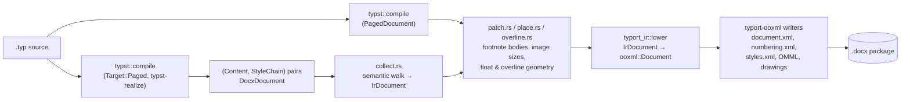

# ECMA-376 feature map

How typort expresses each Typst construct in Office Open XML (ECMA-376), per
compatibility level. Every claim here is verified against the implementation
(`typort-core/src/convert/realize/`, `typort-ir/src/lower.rs`,
`typort-ooxml/src/writer/`) and the test suite; where behavior differs from the
old `compat-modes.md` design doc, the code is authoritative and the difference
is noted.

## Compatibility levels

`CompatMode` is defined twice — `typort_core::compat::CompatMode` (user-facing,
richer degradation formatting) and `typort_ir::CompatMode` (used by the
lowerer). Both accept `c1` / `c2` / `c3`; the CLI flag is `--compat`, default
`c2`.

| Level | Name | Contract |
|-------|------|----------|
| C1 | minimal | Only constructs inside the Typst/OOXML intersection are emitted. Anything outside it is skipped or literalized and reported as a named degradation. |
| C2 | graphical | Default. Everything C1 emits, plus Word's graphical vocabulary (anchored floats, numbered-list patterns, cell shading, section breaks, headers/footers) to preserve appearance where the semantic mapping does not reach. |
| C3 | dynamic | Everything C2 emits, plus Word **field codes** around the values C2 rendered literally: `w:updateFields` in `settings.xml`, ` NUMPAGES ` for `counter(page).final()`, ` NOTEREF <label> \h ` for `counter(footnote).at(<label>)`, ` DATE `/` TIME ` for `datetime.today()`/`now()`, ` DOCPROPERTY <name> ` for `document.<field>` reads, ` SEQ ` for single-piece figure/table/equation numbering, ` STYLEREF "Heading N" ` for pure heading-query page zones, and ` CITATION <key> \l 1033 ` for `@key`/`#cite`. Every field carries the C2 literal as its cached result, so disconnecting all fields reproduces C2 (D1). |

In the tables below, the "C2/C3" column describes what both levels emit; a
row calls out the C3 form explicitly only where C3 differs from C2.

## How to read this document

- Element names use their OOXML prefixes (`w:`, `m:`, `wp:`, `a:`, `mc:`).
- Quoted names like `"vector-image"` are degradation constructs — the
  `construct` string in the `Degradation` report.
- Degradations raised while *collecting* the IR fire at every level (they
  describe aspects no level can express); degradations raised while *lowering*
  are mostly C1-only, because C1 is where the intersection is enforced.
- "Literalized" means the rendered text is kept but the dynamic/semantic
  aspect is dropped; "approximated" means a nearby OOXML construct stands in;
  "skipped" means nothing is emitted.

## Pipeline

## Runs and text

| Typst | OOXML | C1 | C2/C3 |
|-------|-------|----|-------|
| `#text(font:)` | `w:rFonts w:ascii`/`w:eastAsia` (first family → ascii, last → eastAsia) | same | same |
| monospace family (`#raw`, `text(font:)` mono) | `w:rFonts` with the document `code_font` (families detected via `fontdb` `monospace` flag, never by name) | same | same |
| `#text(size:)` | `w:sz` half-points | same | same |
| weight / `#strong` | `w:b` | same | same |
| italic / `#emph` | `w:i` | same | same |
| `#underline` | `w:u w:val="single"`; a custom `offset` is dropped + `"underline-offset"` (all levels) | same | same |
| `#strike` | `w:strike` | same | same |
| `#overline` | C1: dropped + `"overline"`. C2/C3: measured `wp:anchor` line shape (`AnchoredLine`); unmatched runs degrade | dropped + report | `wp:anchor` line; unmatched → report |
| `#highlight` | `w:highlight` (palette-mapped); non-default extent/edges/radius/stroke → `"highlight-geometry"` (all levels) | same | same |
| `#smallcaps`, `smcp`/`c2sc` features | `w:smallCaps` | same | same |
| `#sub` / `#super` | `w:vertAlign` subscript/superscript | same | same |
| `#text(baseline:)` | `w:position` half-points | same | same |
| `#text(fill:)` (non-black) | `w:color` | same | same |
| `#text(tracking:)` | `w:spacing` | same | same |
| ligatures / `num-form` / `num-spacing` | `w:ligatures`, `w:numForm`, `w:numSpacing` | same | same |
| `#text(lang:, region:)` | `w:lang` (document-level via `Normal` style) | same | same |
| `top-edge` / `bottom-edge` metrics | dropped + `"text-edge-metrics"` (all levels) | same | same |
| `#text(hyphenate: false)` | `w:suppressAutoHyphens` in `settings.xml` | same | same |
| `#text(case:)`, `#lower`/`#upper` | literal text transform | same | same |
| smart quotes | literal typographic characters | same | same |
| `stroke`, `kerning`, `spacing`, `overhang`, `costs`, `cjk-latin-spacing`, fractions, slashed-zero, stylistic sets, font variations | not read — dropped silently | same | same |

## Paragraphs

| Typst | OOXML | C1 | C2/C3 |
|-------|-------|----|-------|
| `#par(justify:)` | `w:jc` on `Normal` style; a paragraph whose own chain resolves a different `justify` carries the `w:jc` override (`both`/`left`) | same | same |
| `#align` / folded alignment | `w:jc` per paragraph | same | same |
| `#par(first-line-indent:)` | `w:ind w:firstLine` (+ `w:firstLineChars` for em amounts) on `Normal`; a paragraph whose chain resolves a different amount carries the `w:ind` override (`0` clears a char-based Normal indent; negative is `w:hanging`) | same | same |
| `#par(hanging-indent:)` | `w:ind w:hanging` | same | same |
| `#par(leading:)` | `w:spacing w:line w:lineRule="atLeast"` (cap_height + leading) | same | same |
| `#par(spacing:)` | `w:spacing w:after` (spacing minus leading compensation) | same | same |
| `#par.line(numbering:)` | `w:lnNumType w:distance` in `w:sectPr` | same | same |
| `#block(breakable: false)` / sticky | `w:keepLines` / `w:keepNext` | same | same |
| `#v(amount)` | `w:spacing w:before` on the next paragraph | same | same |
| `#h(amount)` | `w:spacing` (tracking) on a space run | same | same |
| `fr` / ratio / negative `#h`/`#v` | dropped + `"h-fr-space"` / `"v-fr-space"` / `"-ratio-space"` / `"-negative-space"` (all levels) | same | same |
| linebreaks `simplex`/`optimized`, `justification-limits`, widow/orphan costs | not read — dropped silently | same | same |

## Headings

| Typst | OOXML | C1 | C2/C3 |
|-------|-------|----|-------|
| `= Heading` | `w:pStyle Heading1`–`Heading9` (level >5 uses the level-5 size) + `w:bookmarkStart/End` for labels | same | same |
| `#set heading(numbering: "1.1")` | `w:numPr` against a heading `abstractNum` (per-level `lvlText`/`numFmt`); counter divergence vs the rendered number → `"heading-numbering"` approximated | literal `numbering_text` run in the heading paragraph | `w:numPr` mapping |
| numbering via a function or unmappable numeral system | literal text + `"heading-numbering"` literalized (all levels) | same | same |
| `#heading(outlined: false)` | plain paragraph (keeps the number text, keeps the bookmark) so it stays out of the TOC + `"unoutlined-heading"` (all levels) | same | same |

## Lists, enumerations, terms

| Typst | OOXML | C1 | C2/C3 |
|-------|-------|----|-------|
| `- item` | `w:numPr` (`w:numId`/`w:ilvl`) against a bullet `abstractNum`; `indent`/`body-indent` → `w:ind` left+hanging; `spacing` → `w:after` on the item's last paragraph | default bullet; custom markers → `"list-marker"` literalized | custom text markers kept as `bullet` `lvlText` (e.g. `—`, `▸`); function markers → `"list-marker"` |
| `+ item` | `w:numPr` against an enum `abstractNum` with per-level `numFmt`/`lvlText` and `startOverride`; `full:` numbering → multi-level `lvlText` (`%1.%2`) | shared default decimal + `"enum-numbering"` when a non-default pattern would be needed | pattern mapped |
| numeral systems | `numFmt`: arabic→`decimal`, `a`/`A`→`lowerLetter`/`upperLetter`, `i`/`I`→`lowerRoman`/`upperRoman`. Other systems (e.g. CJK) and function numbering → the item's literal `number_text` run instead of `w:numPr` | literal | literal |
| `#enum(reversed: true)` | no OOXML equivalent — items numbered forward | + `"enum-reversed"` literalized | silently forward-numbered (no report) |
| enum with an empty pattern | literal `number_text` runs (all levels, e.g. function numbering whose text was rendered) | same | same |
| `/ term: desc` | plain paragraphs: bold term run + separator + description | same | same |

## Tables and grids

| Typst | OOXML | C1 | C2/C3 |
|-------|-------|----|-------|
| `#table` | `w:tbl` — `tblGrid` column widths, `gridSpan`, `vMerge`, `tblCellMar` (inset), `tblHeader` (header rows), per-cell `w:vAlign`, cell `w:jc`, nested tables | same | same |
| `#table(stroke:)` / `hline`/`vline` | `w:tblBorders` (uniform) or per-cell `w:tcBorders` | same | same |
| `table.cell(fill:)` | `w:shd w:fill` | skipped + `"table-cell-fill"` | `w:shd` |
| `#table(column-gutter:, row-gutter:)` | emulated with transparent `tcBorders` | skipped + `"table-gutter"` | gutter borders |
| unresolved cell grid | falls back to a paragraph stream + `"table-grid-unresolved"` (all levels) | same | same |
| `#grid` | `w:tbl` via the pure `grid_plan` lowering: fixed layout, measured column widths, `trHeight`, `tcBorders` | flattened to paragraphs + `"grid-layout"` | `w:tbl` |
| grid > 63 columns | split into stacked tables + `"grid-column-split"` (all levels) | flattened | split |
| row heights | Typst layout height → `trHeight`; Word may reflow text (registered gap) | flattened | `trHeight` |

## Figures, equations, images

| Typst | OOXML | C1 | C2/C3 |
|-------|-------|----|-------|
| `#figure` | body + caption paragraph; `gap` → spacing; label → bookmark; supplement + number in the caption; C3: a single-piece caption number renders as ` SEQ <Figure\|Table> [\* fmt] ` with the rendered numeral cached | same | C2: literal number / C3: ` SEQ ` field |
| `figure(placement: top/bottom)` explicit | lone-table body → `w:tblpPr` floating table (caption becomes a grid-spanning row); other bodies → anchored `wps:txbx` at the measured position | body kept in flow + `"figure-placement"`/`"placed-content"` | `w:tblpPr` / anchored `txbx`; unmeasured → flow fallback + `"placed-content"` |
| `$x$` / `$ x $` | `m:oMath` inline / `m:oMathPara` block; equation numbering `(1)`; C3: a single-piece numbering pattern renders as ` SEQ equation [\* fmt] ` with the rendered numeral cached | same | C2: literal number / C3: ` SEQ ` field |
| `#image` (raster) | `w:drawing` + `wp:inline` + `a:blip` (`pic:pic`) | same | same |
| `#image` (SVG) | `mc:AlternateContent`: `asvg:svgBlip` (Choice) + PNG `a:blip` (Fallback) | PNG bytes only + `"vector-image"` | full AlternateContent |
| `image(fit: "cover")` | `a:srcRect` l/t/r/b derived from the measured clip window; the declared box stays the `wp:extent` and the full bytes stay embedded | same | same |
| `image(fit: "contain"/"stretch")` | fit aspect dropped; display size still comes from the measured frame | + `"image-fit"` | silently dropped |
| `block(clip: true)`/`box(clip:)` + negative `inset:` | `a:srcRect` l/t/r/b from the clip window vs the image bounds (composes with a cover fit) | same | same |
| `image(alt:)` | no `wp:docPr descr` emitted | + `"image-alt"` | silently dropped |
| PDF image source | skipped + `"pdf-image"` (all levels — the IR path has no rasterizer; the legacy path rasterizes PDF pages) | same | same |

## Footnotes

| Typst | OOXML | C1 | C2/C3 |
|-------|-------|----|-------|
| `#footnote` | real `w:footnote` part + `w:footnoteRef` marker style + `w:footnoteReference` | same | same |
| decimal numbering | `w:numFmt decimal` in `w:footnotePr` | same | same |
| circled (`①`) numbering | `w:numFmt decimalEnclosedCircle` | same | same |
| `counter(footnote).update(0)` in a page header | `w:numRestart eachPage` | same | same |
| unsupported numbering pattern (e.g. `(n)`) | literal marker text + `"footnote-numbering"` | literal + report | footnote still emitted with decimal/`numFmt` numbering — the custom marker silently becomes decimal |
| `footnote.entry(clearance/gap/indent/separator)` | `w:footnotePr` spacing + `w:separator` line stroke | same | same |
| footnote marker inside a context where a `w:footnoteReference` cannot live | literal text + `"footnote"` (all levels) | same | same |
| `#footnote.entry` bodies | collected from the `FootnoteElem` pairs and patched from the `PagedDocument`; a missing entry body → `"footnote-entry-not-found"` | same | same |

## Bibliography and citations

| Typst | OOXML | C1 | C2/C3 |
|-------|-------|----|-------|
| `#bibliography` | `w:sdt` + `w:bibliography` gallery + ` BIBLIOGRAPHY ` field wrapping cached entry paragraphs; `customXml/item1.xml` carries the hayagriva metadata Word's field needs | same | same |
| bibliography entries | collected from the fragment realization (link marker + `BibEntry` pdf-tag body → `bib-N` bookmarks). On the current corpus the entry grid is not surfaced, so the field renders **empty** + `"bibliography-entries"` (all levels; registered gap — see `fallback-registry.md`) | same | same |
| `@key` / `#cite` | C3: ` CITATION <key> \l 1033 ` complex field with the rendered marker cached (D2 — the marker stays literal at C1/C2; when the target entry bookmark resolved it is wrapped in `w:hyperlink w:anchor`). `customXml/item1.xml` carries the hayagriva metadata at every level | same | C3 emits the field |
| `#cite(form:)` | rendered form literal | same | same |

## Outlines and cross-references

| Typst | OOXML | C1 | C2/C3 |
|-------|-------|----|-------|
| `#outline()` | title paragraph + ` TOC \o "1-N" \h \z \u ` complex field | same | same |
| `outline(target:)` non-heading | title paragraph only (entries unrecoverable) | + `"outline-target"` | silently title-only |
| `outline(indent:)` custom | TOC field without per-level indent | + `"outline-indent"` | silently dropped |
| `#link(url)` | `w:hyperlink r:id` / `HYPERLINK` field | same | same |
| `@label` | ` REF <label> \h ` complex field with the rendered text cached | same | same |
| `@label` with `supplement: auto`/`Page` | ` PAGEREF <label> \h ` | same | same |
| unresolved label/link target | literal text + `"unresolved-link"` (all levels) | same | same |
| `context counter(page)` in body text | ` PAGE ` field with cached display text | same | same |
| `context counter(page).final()` | C3: ` NUMPAGES ` field with the rendered total cached | literal + `"page-counter-value"` | C3 emits the field |
| arithmetic on `counter(page)` | literal + `"page-counter-value"` (all levels) | same | same |
| `counter(footnote)` references | literal + `"footnote-counter-reference"` (C1/C2). C3: ` NOTEREF <label> \h ` with the rendered marker cached; the labelled `FootnoteElem` carries a `w:bookmarkStart`/`w:bookmarkEnd` of the label's name — a reference whose label never lands on a footnote stays literal + the same report | same | C3 emits the field |
| labels on headings/figures/equations | `w:bookmarkStart`/`w:bookmarkEnd` | same | same |
| `#quote` | left-indented paragraphs; attribution appended | same | same |

## Page setup

| Typst | OOXML | C1 | C2/C3 |
|-------|-------|----|-------|
| `#set page(width/height/margin)` | `w:pgSz` + `w:pgMar`; `flipped` → `w:orient="landscape"` | same | same |
| `#set page(columns:)` | `w:cols w:num` + `w:cols w:space` (gutter) | same | same |
| `#set page(header-ascent/footer-descent)` | `w:header`/`w:footer` in `w:pgMar` | same | same |
| `#set align(horizon/bottom)` page | `w:vAlign` in `w:sectPr` | same | same |
| `#set page(numbering: "…")` | `w:pgNumType w:fmt` per section; unmappable pattern → `"page-numbering-pattern"` and glyph-based detection (all levels) | same | same |
| page number restart | `w:pgNumType w:start` when the rendered footer numbering diverges | same | same |
| `#set page(header:/footer:)` | `w:headerReference`/`w:footerReference` (default, first, even) + `w:titlePg`/`w:evenAndOddHeaders`; bare page numbers become ` PAGE ` fields inside the generated part. C3: a zone whose whole content is a heading query (`query(selector(heading).before(here()))`, `where(level: N)` picked up) renders as ` STYLEREF "Heading N" ` with the extracted heading text cached; mixed-markup zones stay literal | page-1 zone kept as literal paragraphs + `"header-footer-variant"` | three slots; mid-document variants beyond what the slots express → `"header-footer-variant"` report |
| `#set page(margin: (inside/outside))` two-sided | `w:mirrorMargins` is **not** emitted | + `"mirrored-margins"` | silently kept as resolved left/right |
| `#set page(foreground:/background:)`, `page(fill:)` | not emitted; in C1 the furniture text is literalized into the body | + `"page-foreground"` literalized | silently dropped |
| `#set document(title/author/description/keywords/date)` | `docProps/core.xml` (`dc:title`, `dc:creator`, `dc:subject`, `cp:keywords`, `dcterms:created`); title falls back to the first heading | same | same |
| `context document.<field>` reads | C3: ` DOCPROPERTY <name> ` with the rendered text cached — `title`→`Title`, `author`→`Author`, `keywords`→`Keywords`, `description`→`Comments`, `date`→`CreateDate`; other fields stay literal | same | C3 emits the field |
| `context datetime.today()`/`now()` (any display form) | C3: ` DATE `/` TIME ` with the rendered text cached — an explicit `.display(format)` keeps its rendered text as the cached result; the field carries no `\@` switch | same | C3 emits the field |

## Sections, breaks, placement

| Typst | OOXML | C1 | C2/C3 |
|-------|-------|----|-------|
| mid-document `#set page(...)` change | `w:sectPr` transitions ending each section (`nextPage`, or `continuous` when only numbering/format changes) | sections collapsed to a single section + `"section-break"` report | `w:sectPr` per section |
| `#pagebreak` | `w:br w:type="page"`; `weak:` honored — no break when the page is already fresh, and runs of consecutive breaks coalesce | same | same |
| `#pagebreak(to: odd/even)` | `w:sectPr w:type` `oddPage`/`evenPage` (emitted at **all** levels — it is an authored break, not a style change) | same | same |
| `#linebreak` | `w:br` | same | same |
| `#colbreak` | `w:br w:type="column"` | same | same |
| `#columns(n)[…]` block | body kept flat + `"column-block"` (all levels) | same | same |
| `#place(float: true)` | `wp:anchor` `w:drawing` with measured page-absolute position; `wrapTopAndBottom` or `wrapSquare`, `distT`/`distB` from `clearance:`, `behindDoc="0"`; a lone-table body → `w:tblpPr` floating table instead | body kept in flow + `"placed-content"` report | anchored float / `w:tblpPr`; unmeasured → flow fallback + `"placed-content"` |
| `#place` non-float | `wp:anchor` measured the same way: `wp:wrapNone`, `behindDoc` from paint order (behind when the page paints more content after the place); text in editable `wps:txbx` (`w:jc` pinned), images as `pic:pic`, a filled `rect` as `a:solidFill` on the shape; a lone-table body → `w:tblpPr`; a box fully inside a side margin anchors `relativeFrom="margin"` | + `"placed-content"` | anchored overlay / `w:tblpPr`; unmeasured → flow fallback + `"placed-content"` |
| `float(dx:/dy:)` offsets | included in the anchor position | n/a | same |

## Shapes, lines, transforms

| Typst | OOXML | C1 | C2/C3 |
|-------|-------|----|-------|
| `#rect`/`#square`/`#ellipse`/`#circle`/`#polygon`/`#curve`/`#path` with text | body text kept; fill → `w:shd` on the paragraph (block) or `w:shd` on runs (inline) | body text + `"shape"` report | shaded text; stroke/radius/geometry dropped silently |
| bare shapes (no text) | nothing | + `"shape"` | silently nothing |
| `#line` horizontal | paragraph `w:pBdr` bottom border | same | same |
| `#line` angled/vertical | treated as a shape — geometry dropped | + `"shape"` | silently dropped |
| `#move`/`#rotate`/`#scale`/`#skew` | content kept, transform dropped + `"moved-content"` / `"rotated-content"` / `"scaled-content"` / `"skewed-content"` (all levels) | same | same |
| `#hide` | content and its space dropped + `"hidden-content"` (all levels) | same | same |
| `#box`/`#block` width/baseline/fill/stroke | `"box-width"`/`"box-baseline"`/`"box-decoration"`/`"block-width"`/`"block-decoration"` (all levels); body kept | same | same |
| `#pad` | padding dropped, body kept | same | same |
| `#repeat`/`#layout`/`#state`/`#counter` displays / `#context` | literalized where the rendered text is available + `"context-content"`/`"layouter-body"`/`"page-counter-value"`; otherwise dropped | same | same |

## Design rulings that constrain the code

Carried over from the retired `compat-modes.md`; still binding.

**C1 skip semantics.** "Skip" means skip the unsupported *aspect*, never the
whole element when something expressible remains: S1 drop the property, keep
the text (overline, cell fill); S2 drop position/structure, keep the text in
flow (floats, placed content, shapes); S3 drop the element only when nothing
expressible remains (textless shapes); S4 fall back to a representable form
(list/enum numbering, heading numbering); S5 keep the compile-time literal
when the dynamic aspect is unrepresentable (counter displays — losing
dynamicism is not itself reported). C1 never silently drops text.

**C2 rules.** Tricks never degrade an existing semantic mapping (headings stay
`Heading` styles, lists stay `w:numPr`, text stays searchable runs); a trick
is additive — removing it leaves valid content, not an empty shell; no fake
semantics (literal numbers are text, not `w:numPr`); when a trick cannot be
measured it falls back to the C1 form plus a report, never a misplaced trick.

**Layering.** `C3 = C2 + fields`, strictly: C1 ⊂ C2 ⊂ C3 — decided 2026-11-16
(D1). The acceptance invariant, now enforced by the C3 field layer: a C3
field's cached result equals the C2 literal output, so disconnecting all
fields reproduces C2. `w:updateFields` in `settings.xml` is emitted at C3
only (D5 — implemented with the field layer).

**Aspect-level SVG embedding.** The C2 fallback ladder's last resort, when no
native or shape encoding exists, is embedding the construct as an SVG part
(`asvg:svgBlip` + PNG fallback) — with an `Approximated` degradation noting
the text is no longer in Word's text layer. It must not replace a native
encoding that exists.

**Citations.** C1/C2 output keeps literal markers (+ internal links when
entries resolve), never `CITATION` fields — the L6/D2 ruling; C3 emits
` CITATION <key> \l 1033 ` with the literal marker cached (D2, decided when
the C3 field layer landed).

## Degradation report

Every conversion returns the document plus a `Vec<Degradation>` — `span`,
`construct` (stable string for tests), `action` (`skipped` / `literalized` /
`approximated`), and a human message. `--format json` emits them structured;
text mode prints them after the output path. Collector-raised constructs
(`hidden-content`, `moved-content`, `text-edge-metrics`, `highlight-geometry`,
`h-fr-space`, `context-content`, `page-counter-value`, `footnote-counter-reference`,
`unresolved-link`, `bibliography-entries`, `footnote-entry-not-found`,
`grid-column-split`, `table-grid-unresolved`, `box-*`, `column-block`,
`unoutlined-heading`, `placed-content` for non-float placement, …) fire at
every level; the C1-specific gate adds `grid-layout`, `vector-image`,
`image-fit`, `image-alt`, `list-marker`, `enum-numbering`, `enum-reversed`,
`table-cell-fill`, `table-gutter`, `shape`, `page-foreground`,
`section-break`, `header-footer-variant`, `mirrored-margins`,
`page-numbering-change`, `footnote-numbering`, `outline-target`,
`outline-indent`, `figure-placement`, `show-*-rule` and the
source-AST-set-rule reports.

## Open items

Recorded here so future C3 work and known gaps have one permanent home; the
per-feature *degradation* list above is exhaustive.

- **C3 field layer — remainder.** The layer landed: `w:updateFields`,
  `NUMPAGES`, `NOTEREF` + footnote bookmark, `DATE`, `DOCPROPERTY`, `SEQ`
  (figure/table/equation captions), `STYLEREF` for pure heading-query page
  zones, `CITATION` + the pre-existing `customXml` sources part, and the
  `HYPERLINK` field form (`w:fldSimple`, already emitted at every level).
  What it deliberately does not cover:
  - `SECTIONPAGES` — Typst has no per-section total-page construct;
    `counter(page).final()` is always whole-document, so ` NUMPAGES ` is the
    only faithful mapping.
  - `TIME` — `datetime.now()` does not exist in Typst 0.15, so no source
    expression can feed it; the mapping lands if Typst adds one.
  - `SEQ` for enums — C2 never emits literal enum numbering (unmapped
    numeral systems fall back to `w:numPr` decimal, so there is no literal
    to cache); native `w:numPr` numbering is left alone by design.
  - `DATE \@ `/`DOCPROPERTY` format switches, and `STYLEREF` for zones
    mixing the heading query with literal markup.
- **`enum(reversed:)`** is silently forward-numbered at C2/C3; only C1
  reports it.
- **`outline(target:)`** non-heading and custom `outline(indent:)` are silently
  reduced/dropped at C2/C3; only C1 reports them.
- **Custom `#footnote(numbering:)`** silently falls back to the `numFmt` in
  effect at C2/C3; only C1 reports it.
- **Two-sided margins** keep resolved left/right at C2/C3 without emitting
  `w:mirrorMargins`; only C1 reports it.
- **`page(fill:)`/foreground/background** are dropped at C2/C3 silently; only
  C1 literalizes the furniture text and reports.
- **Bare/angled shapes** are silently dropped at C2/C3; only C1 reports them.
- **Dual `CompatMode`/`Degradation` definitions** in `typort-core` and
  `typort-ir` remain to be unified.
- **Image `alt:`** is never emitted (`wp:docPr descr` is a backlog item at
  every level); `fit:` contain/stretch is silently dropped at C2/C3 (cover
  lowers to `a:srcRect`).
- **Grid row heights** are fixed from Typst layout (`trHeight`), not Word
  reflow; wide grids split at 63 columns.
