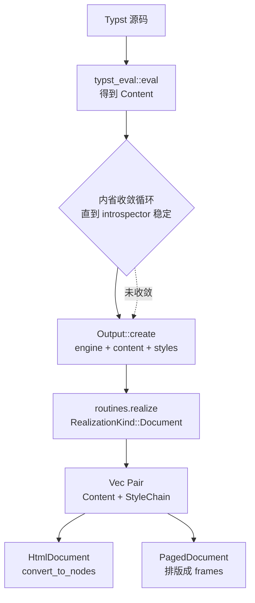
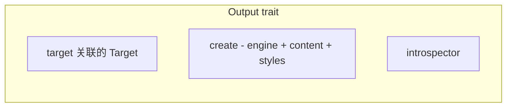
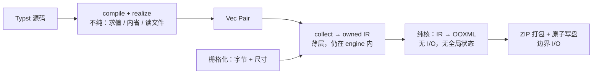

# Spike：不 fork 编译器，能否拿到 (Content, StyleChain)

日期：2026-11-16。基线：Typst 0.15.1（tag `v0.15.1`），typort `feature/docx-backend`。
范围：只调研，不改实现代码。结论服务于 `docs/PLAN-docx-backend.md` 的步骤 2。

## 结论先行

可以。第三方 crate 不需要 fork 编译器就能拿到已实现、带样式的语义内容。
`typst::compile` 是对 `Output` trait 的泛型函数，而 `Output` 是公开 trait；
`typst-realize::realize` 是公开函数，`Routines` 表、`Pair`、`RealizationKind`、
`Arenas`、`Locator` 全是公开类型。最小可行形态是：自己实现一个
`Output`（`DocxDocument`），在 `create()` 里调一次 `realize`，拿到
`Vec<Pair>` 再降为自有的 owned IR。真正的难点不在“能不能拿到”，而在三个
细节：`Output` 必须提供一个 introspector；`Target` 只有三个变体，没有 Docx；
`Vec<Pair>` 带生命周期，不适合直接做纯核的输入。

## 编译器全景：只有一条求值，两条生产路径



`typst::compile<T: Output>`（`crates/typst/src/lib.rs`）的流程是：求值一次，
然后在循环里反复调用 `T::create`，直到内省收敛。所以“HTML 与 Paged 两条
生产路径”不是两个编译器，而是同一个求值器之上的两个 `Output::create`
实现。两条路径共享求值，也共享同一次 `realize` 调用——Paged 路径
（`crates/typst-layout/src/pages/mod.rs`）和 HTML 路径
（`crates/typst-html/src/document.rs`）都是先 `realize(Document)` 再各自
往下走。这对我们是好消息：第三条路径（DOCX）可以站在同一个位置上，
不需要重复求值，也不需要两次编译。

`Output` trait（`crates/typst-library/src/foundations/target.rs`）只有三个
方法，全部公开：



`create` 收到 `styles` 时，编译器已经把 `TargetElem::target.set(T::target())`
链进去了。也就是说，`create` 内部看到的样式链天然带有目标信息。

## 现有什么 API：公开 vs 内部

| 东西 | 位置 | 可见性 | 说明 |
| --- | --- | --- | --- |
| `typst::compile<T: Output>` | `typst` | 公开 | 泛型编译入口；第三方可传自己的 `Output` |
| `Output` trait | `typst_library::foundations::target` | 公开 | `target()` / `create()` / `introspector()` |
| `Routines` 结构 | `typst_library::routines` | 公开，字段全公开 | 函数指针表，本质是动态链接 |
| `Routines::realize` 字段 | 同上 | 公开 | 签名见下 |
| `typst_realize::realize` | `typst-realize` | 公开函数 | 与 `Routines::realize` 是同一函数 |
| `Pair<'a>` | `typst_library::routines` | 公开类型别名 | `(&'a Content, StyleChain<'a>)` |
| `RealizationKind` | 同上 | 公开枚举 | `Bundle` / `Document` / `Fragment` / `Par` / `Math` |
| `Arenas` | 同上 | 公开，可 `Default` | realize 期间的 arena；返回内容活多久，它就得活多久 |
| `Locator::root()` / `split()`、`SplitLocator` | `typst_library::introspection` | 公开 | `create` 内自己建 locator，不需要编译器给 |
| `Engine` 全字段 | `typst_library::engine` | 公开 | `world` / `library` / `introspector` / `sink` / `route` 都能直接读 |
| `Library.routines` | `typst_library` | 公开 | `&'static Routines` |
| `typst_html::html_document` | `typst-html` | 公开函数 | 但只能在有 `Engine` 的地方调，即 `create` 内部 |
| `HtmlDocument` / `HtmlElement` / `HtmlNode` | `typst-html` | 公开 | 见下节：节点携带的样式极少 |
| `Introspector` trait、`ElementIntrospector` / `ElementIntrospectorBuilder` | `typst_library::introspection` | 公开 | 自建 introspector 的零件 |
| realize 内部的 `State` / `GroupingRule` / 分组规则表 | `typst-realize` | 私有 | 不需要碰；调 `realize` 就够了 |
| `html_document_impl`（memoized）、`convert_to_nodes` | `typst-html` | 私有 | HTML 的 walk 逻辑不公开复用 |
| `PagedIntrospectorBuilder` | `typst-layout` | 私有 | 同理 |

另外：`typst-realize` 已在 crates.io 发布（0.13 / 0.14 / 0.15 均有），
可以直接依赖；也可以只依赖 `typst` crate——它用 `pub use typst_library::*`
把 `routines` 等都重导出了。

`realize` 的完整签名（`crates/typst-realize/src/lib.rs`）：

```rust
pub fn realize<'a>(
    kind: RealizationKind,
    engine: &mut Engine,
    locator: &mut SplitLocator,
    arenas: &'a Arenas,
    content: &'a Content,
    styles: StyleChain<'a>,
) -> SourceResult<Vec<Pair<'a>>>
```

它做的事情：递归应用样式和 show 规则，把内容展平成“Well-known”的元素
列表，每个元素配上它自己的 `StyleChain`。分组规则（段落成组、数学、
列表等）由 `kind` 决定；文档级用 `RealizationKind::Document { info }`，
还会顺带从 `set document` 规则填 `DocumentInfo`。

## HtmlDocument 的节点到底携带多少样式

很少。这是步骤 2 必须面对的事实。

`HtmlElement` 有一个公开的 `css: css::Properties` 字段，但注释写明
“Currently only used for generated styles”。实际生成时填进去的只有：

- `display`（inline-block 等）
- `white-space: pre-wrap`
- `list-style-type: none`
- `text-decoration`（underline / overline）
- `font-variant-caps`
- `color`（仅一处：`html_span_filled`，注释写明是“temporary workaround
  until `TextElem::fill` is supported in HTML export”——即正文 fill 目前
  在 HTML 导出里就是不支持的）
- `image-rendering`、`width` / `height`、`math-shift`
- 公式用的 `<style>` 块（`EQUATION_CSS_STYLES`）

没有字体、没有字号、没有行距、没有对齐。最后 `css::resolve_inline_styles`
只是把这些 `css` 属性合并进节点的 `style` attribute 而已。

也就是说，`HtmlDocument` 今天是一份**语义完整、样式几乎空白**的文档。
这正是 typort 现在要靠 PagedDocument 反推字体字号的原因，也是路径 A
必须让上游补的东西。机制本身已经存在（`HtmlElem.css` 同样走
`StyleChain` 取值），缺的是“把计算后的文本样式写进去”这一步。

## Target：没有 Docx，以及它对单源导出的影响

`Target` 枚举（`crates/typst-library/src/foundations/target.rs`）只有三个
变体：`Paged`（默认）、`Html`、`Bundle`。没有 Docx。`target()` 是
contextual 函数，从样式链读 `TargetElem::target`。

影响有三层：

1. **同一份源码在 HTML 与 Paged 编译下可能产出不同内容。** 模板可以
   `if target() == "html"` 走完全不同的 show 规则分支（文档里就有这样的
   例子）。所以 typort 现在的双编译对齐在原理上就不保证一一对应——不是
   某个 case 没处理好，而是两个输出本来就可能装着不同的东西。
2. **target 在一次编译内也会变。** HTML 导出里 `html.frame()` 内部的
   target 是 `paged`。单源导出必须接受：IR 里个别子树可能来自另一个目标
   的分支。
3. **自定义 `Output` 必须选一个现有变体。** 选 `Paged`：两种 show 输出
   各有利弊，Paged 的输出更接近 DOCX 的块模型且保留字段。Paged 与 Html
   都有内置 show 规则（Typst 0.15.1：Paged 59 条，Html 38 条）——
   “Paged 下无内置规则”是错的（见下节修正，探针实测）。差别在于输出
   形态：Html 把 TableElem 投影成 `<table>`（单元格只剩
   colspan/rowspan，fill/stroke/inset/align/列宽全丢）；Paged 把元素
   投影成 BlockElem/ParElem 容器 + 渲染文本（元素本身被吃掉，但字段
   以 materialize 形式留在元素上，身份保留在 tag 流里）。模板走打印
   分支（box、stroke、绝对定位）对 DOCX 反而是对的分支——Word 是分页
   文档，这些正是 C2 要表示的东西。
   - 选 `Html` 的代价：`compile` 要求 Library 启用 `Feature::Html`，
     否则直接报错；启用后每次编译多一条“html export is under active
     development”的 warning（上游 issue #5512）；模板的 HTML 分支可能
     产出 `html.elem(...)` 原生 HTML 内容——它是 `Content`，可以走
     realize，但降级到 OOXML 时要显式处理（报告降级，而不是静默丢掉）。
   - 加一个 `Target::Docx` 变体需要改上游枚举，是 breaking change，不在
     本分支的掌控内。

### 修正（2026-11-16）：Html 下 pairs 里没有语义元素，步骤 2 改走 Paged

TableElem 调查的结论，推翻上节“推荐选 Html”的前提：

- `realize` 的 `verdict` 按 StyleChain 里的 target 查内置 show rule
  （`styles.get(TargetElem::target)` →
  `engine.library.rules.get(target, elem)`，typst-realize lib.rs）。
  TABLE_RULE 只注册给 Html（typst-html rules.rs:68
  `rules.register(Html, TABLE_RULE)`），其余三十来条 Html 规则亦然
  （段落、标题、列表、引用、脚注、目录、数学、图片……）。
- 所以 Target::Html 下，pairs 里的 TableElem 已被改写成 `<table>`
  （单元格只剩 colspan/rowspan），表格问题原样保留，仍需 introspector
  反查——即现在 M2/table_align 的做法。B 路原样写并不能解决表格问题；
  “Html 分支产出流式内容相对容易降级”只在模板分支层面成立，在 pairs
  层面 Html 意味着语义已被改写。
- 步骤 2 改走 Target::Paged：`compile` 对 Paged 不要求
  `Feature::Html`、不发 warning（typst lib.rs `compile_impl` 的
  match）；`PagedDocument` 本身就是 `Target::Paged` 的 `Output`，
  公共 API 走得通。

探针复核（2026-11-16，`~/workspace/realize-probe/report.md`，115 对
dump）：上段“Paged 下没有任何元素的内置规则，TableElem 等保持语义”
是错的，须重写前提：

- Typst 0.15.1 的 `typst-layout/src/rules.rs` 为 `Target::Paged`
  注册 **59 条**内置 show 规则（Html 在 `typst-html/src/rules.rs`
  注册 38 条）。HEADING、FIGURE、FIGURE_CAPTION、CITE_GROUP、
  BIBLIOGRAPHY、TABLE、TABLE_CELL 等规则都会吃掉语义元素：
  HeadingElem 变成 BlockElem，Strong/Emph 并入 TextElem 属性，
  CiteGroup 被渲染成 `[1]` 文本。**Paged 与 Html 的差别不是“语义
  vs 丢失”，而是两种不同的 show 输出**——Html 投影成标签（丢
  fill/stroke/inset/align/列宽等），Paged 投影成 BlockElem/ParElem
  容器 + 渲染文本（丢的是元素本身，但字段以 materialize 形式留在
  元素上，身份保留在 tag 流里）。
- 因此 Target 改走 Paged 的结论仍成立，但理由须改成：两种 show 输出
  各有利弊，Paged 的输出更接近 DOCX 的块模型且保留字段。
- **Table 仍是缺口**：TableElem 在 pairs 任何位置都没有 tag（藏在
  figure 的 BlockElem 体内，从未被 `visit`），且 `grid: None`（未
  synthesize；字段都在：列 1fr/2fr/1fr、gutter 3pt、inset 6pt、
  fill/align 闭包、stroke 0.5pt 灰、合并格 colspan 2）。对照：同一份
  文档里 GridElem 的 grid 已解析（`Some(CellGrid)`）。脚注正文也不在
  pairs 里。解决路二选一待验证：对 BlockElem 体再调一次 realize
  （`RealizationKind::Fragment`），或从伴生 Paged 取数——Docx 与
  Paged 两次编译的 Location 完全一致，跨编译匹配成立。
- **introspector 必须递归收嵌套 tag**：只用顶层 TagElem 对建
  introspector 是 blocker——`CITE_GROUP_RULE` 调 `Works::citation`，
  查 engine introspector 里的 CiteGroup，顶层流里没有，`citation
  could not be located` 每轮都报、最终轮编译失败。修复是按 pairs 顺序
  扫描，遇到 ParElem/BlockElem 就地递归进 body，把体内 TagElem 也喂给
  `builder.discover_tag`；修复后第 2 轮起自建 introspector 有 2 个
  citegroup，编译通过，引用渲染正常。
- 代价（开工时逐项验证）：IR 必须原生处理全部三十来种语义元素
  （列表 pattern、标题编号、脚注收集、目录、引用标记、数学、图片……
  ——注意 Strong/Emph 等已被 show 规则并入 TextElem 属性，IR 里它们
  是 run 属性而非独立变体）；参考文献条目正文已由 Typst 自己的
  BIBLIOGRAPHY_RULE（内含 hayagriva）渲染进 pairs，**不需要自己接
  hayagriva 渲染条目**（hayagriva 在 typort 里只剩 `b:Sources` 与自
  定义 CSL）；`html.elem` 原生内容无 Paged 规则，留在 pairs 里要走
  C1 降级；模板走打印分支（对 DOCX 反而是对的分支——Word 是分页文
  档，box/stroke/绝对定位正是 C2 要表示的东西）。
- 仍需 PagedDocument 作伴生输入（两设计皆然）：绝对几何（列宽、图
  尺寸、边区）、页码（M8 缓存文本、目录页码）、running headers、逐页
  脚注编号、脚注正文——这些值只在布局后存在，realize 本身给不出。
- 入口决策：探针已完成（GO，有条件），下一步先做最小验证闭环
  （Fragment 再实现 vs 伴生取表，二选一）再定 IR 形态；不要直接按
  原草图的 `Target::Html` 开工。

## 最小代码草图：拿到 (Content, StyleChain)

下面是第三方 crate 内可行的最小形态。关键点：`Output::create` 内部有
一切需要的东西，不需要编译器再给什么。

```rust
use typst::foundations::{Content, Output, StyleChain, Target};
use typst::introspection::{Introspector, Locator};
use typst::engine::Engine;
use typst::diag::SourceResult;
use typst::model::DocumentInfo;
use typst::routines::{Arenas, RealizationKind};

pub struct DocxDocument {
    // 自有的 owned IR + introspector（见下）。
}

impl Output for DocxDocument {
    fn target() -> Target {
        Target::Paged // 见上节修正：Html 下 realize 会改写语义元素
    }

    fn create(
        engine: &mut Engine,
        content: &Content,
        styles: StyleChain,
    ) -> SourceResult<Self> {
        let mut info = DocumentInfo::default();
        info.populate(styles);
        info.populate_locale(styles);

        let mut locator = Locator::root().split();
        let arenas = Arenas::default();

        // 唯一的 realize 调用：show 规则、分组、空白折叠都在这里面。
        let pairs = (engine.library.routines.realize)(
            RealizationKind::Document { info: &mut info },
            engine,
            &mut locator,
            &arenas,
            content,
            styles,
        )?;

        // pairs: Vec<(&Content, StyleChain)>
        // 下一步：把它降为 owned IR（见 §纯函数化）。
        // 嵌套片段（脚注体等）用 RealizationKind::Fragment 再 realize，
        // 模板是 typst-html 的 fragment.rs。
        todo!("lower pairs into owned IR")
    }

    fn introspector(&self) -> &dyn Introspector {
        todo!("见下")
    }
}

// 调用方只有一行，和现在调 HtmlDocument / PagedDocument 一样：
let doc = typst::compile::<DocxDocument>(&world).output?;
```

三个注意点：

- **`create` 会被调多次。** 编译循环为等内省收敛会反复调 `create`，
  所以 `create` 内不能累积跨调用的状态；所有状态放局部变量。
- **introspector 是必须自己解决的一块。** `Output::introspector()` 是
  trait 的一部分，编译循环靠它判断收敛。现有两个实现都是在共享的
  `ElementIntrospector` / `ElementIntrospectorBuilder` 之上搭的，喂的是
  文档的 tag 流；`realize` 的输出里本来就带 `Tag` 对（`to_tag`）。探针
  已钉死喂法（2026-11-16）：**必须递归收嵌套 tag**——按 pairs 顺序
  扫描，遇到 ParElem/BlockElem 就地递归进 body，把体内 TagElem 也喂给
  `builder.discover_tag`；只收顶层 tag 是 blocker（引用编译失败，见
  上节探针复核）。
- **`Arenas` 的生命周期。** `realize` 返回的 `Pair` 借用 `content`、
  `styles` 和 arenas 里的东西；`create` 返回之前必须把需要的值复制进
  自有结构，不能把借用带出 `create`。

## 步骤 2 的两条路

### A：上游 typst-html 暴露样式信息

上游要改的东西：

- 在 `typst-html` 的 `convert` / `rules` 里，把计算后的文本样式
  （字体、字号、fill、粗斜体、对齐、行距等）也写进节点的 `css` 属性。
  机制现成（`HtmlElem.css.get_cloned(styles)`），缺的是逐项填值。
- 或者更进一步：给 `HtmlDocument` 加一个取每节点 `StyleChain` 的公开
  API。
- 布局类内容（`#align`、`#place`、部分 `#grid`）今天在 HTML 里直接
  丢失，A 路径要彻底成立，上游还得给它们补 HTML 表示，否则 recovery
  层还得留着。

| 维度 | 评价 |
| --- | --- |
| 优点 | 下游核心变成 `HtmlDocument -> OOXML`，输入是 owned 的普通数据，没有生命周期，没有 Engine；上游的 walk（show 规则、片段、脚注）只维护一份 |
| 优点 | `HtmlDocument` 已有 `Clone` / `Hash` / `Debug`，单测可以直接构造节点，不用编译器 |
| 缺点 | 完全取决于上游的设计与排期；HTML 导出本身还挂着“under active development，勿用于生产”的 warning |
| 缺点 | 样式载荷长什么样由上游定；我们要的未必是它愿意给的 |
| 缺点 | 即使样式补齐，布局类内容的 HTML 表示仍是未知数 |

### B：自己走一遍 Content 树，改发 OOXML

自己实现 `Output`（草图见上节），在 `create()` 里调一次 `realize`，
然后按自己的 walk 把 `Vec<Pair>` 降为 owned IR，再由 IR 出 OOXML。
walk 的模板是 `typst-html` 的 `convert_to_nodes` + `rules.rs`，
但只借鉴结构，不复用代码（那些是私有的）。

| 维度 | 评价 |
| --- | --- |
| 优点 | 不依赖上游；今天列出的 API 全是公开的，可以立即开工 |
| 优点 | 单次编译；`#align` / `#place` / `#grid` 在 Content 树里天然有位置，不用事后找回 |
| 优点 | 目标选择、降级报告、IR 形态全由我们定 |
| 缺点 | walk 逻辑要自己维护一份，和上游 `typst-html` 的语义保持同步是长期成本（show 规则、片段、脚注、数学都要对齐） |
| 缺点 | 嵌套 realize（脚注体、图注等）与 introspector 自建是两块 fiddly 的活 |
| 缺点 | 模板的 `target()` 分支内容（`html.elem` 等）要自己显式处理 |

### 需要的上游改动对照

| 改动 | A 需要 | B 需要 |
| --- | --- | --- |
| `typst-html` 填充计算后的文本样式 | 是，核心依赖 | 否 |
| 布局类内容的 HTML 表示 | 是，否则 recovery 留着 | 否 |
| `Target::Docx` 新变体 | 否（可选，有了更好） | 否（可选，有了更好） |
| 任何新公开 API | 可能（按节点取 `StyleChain` 的 API） | 否 |
| `Feature::Html` 启用 + 接受 warning | 否（A 本来就是 HTML 编译） | 是（选 `Target::Html` 的代价） |

## 纯函数化评判（本分支新增要求）

评判标准：纯函数 = 显式输入 → 输出，无隐藏状态（无全局可变、无缓存
依赖），无 I/O，副作用只在边界。单元测试只针对纯函数写；需要编译器
参与的部分用最小夹具覆盖。

### 哪条路更容易把核心做成纯函数

**A 更容易——如果上游先交付。** 核心的输入 `HtmlDocument` 是 owned 的
普通数据，没有生命周期，不碰 `Engine`，单测可以直接构造节点。纯核的
形态就是 `HtmlDocument -> OOXML 模型 -> XML 字符串`，干净。

**B 也能达到同等纯度，但要多一层。** `realize` 返回的 `Vec<Pair<'a>>`
借用 content、styles 和 arenas，生命周期会把 arena 依赖拖进核心，单测
要搭 Library / Arenas / Engine，笨重。所以 B 必须在 `realize` 之后立刻
加一层转换：`pairs -> owned IR`，把计算值复制进普通结构体（不留借用，
除了诊断用的 span），之后的所有 lowering 都只认 owned IR。转换层本身很
薄，lowering 完全纯、可单测。代价是一个要自己设计并维护的 owned IR 类型。

关键设计点：把 owned IR 做成 A / B 两条路的公共接缝。B 先用自己的
collect 实现喂它；将来 A 哪天成立了，collect 换成 `HtmlDocument -> IR`，
纯核一行不用动。

### 注定不纯的部分，以及怎么隔离

| 不纯的东西 | 为什么不纯 | 隔离方式 |
| --- | --- | --- |
| 求值 + realization | 执行用户代码（show 规则里任意 Typst 代码）、经 World 读文件、query / state 内省、多遍收敛 | 全部留在 `typst::compile` 一侧；核心只收它的产物，不直接调 |
| 字体解析 / 塑形 | 依赖系统字体与环境 | B 路径不做分页排版就不需要它；不要为样式再编译一份 Paged |
| SVG / CeTZ 栅格化 | 依赖字体库与渲染器 | 栅格器留在边界；核心只收显式输入（字节 + 尺寸），可替换 |
| 包下载（网络） | World 内部行为 | 核心不碰 World；测试用固定输入的 world |
| `today()`、`sys.inputs`、随机数 | World 提供的输入，随环境变 | 同上：输入显式化，不在核心里现取 |
| 诊断 sink | 副作用通道 | 改成显式返回值（`Vec<诊断>`），不走全局 |
| 文件 I/O 与 ZIP 打包 | I/O | 边界；写盘原子化（PLAN 步骤 1 已定） |
| comemo 缓存 | Typst 内部的记忆化 | 对同一输入确定；测试用全新 world，不依赖缓存状态；核心函数本身感知不到它 |

隔离形态：



硬规则：纯核所在的 crate 不许依赖 `World` / `Engine` / `PagedDocument`。
如果将来某功能非要分页几何不可（例如现在 recovery 层做的事），几何必须
以显式数据结构（如 `GeometryInput`）从边界喂进来，绝不能在核心里再调
一次 compile。`create()` 的多次调用特性也要求：collect 不许在调用之间
攒状态。

## 推荐

**选 B：自己实现 `Output`，一次 `realize`，自有 owned IR，纯 lowering。**

理由：

- 今天列出的 API 全是公开的，不用等上游；A 的前置条件（上游补样式、
  补布局表示）不在我们掌控内，且 HTML 导出本身还挂着“勿用于生产”的
  warning。
- B 的纯度可以做到和 A 一样好，代价只是一个 owned IR 层；而这个 IR 层
  恰好是将来切到 A 时的接缝，不会白写。
- `typort-ooxml`（typed IR + writer）与 `typort-math`（OMML）不用动；
  要换的是 typort-core 的输入形态与三路事实源，正好是 PLAN 步骤 2
  的范围。
- target 改走 Paged（见上节修正）：不要求 `Feature::Html`，没有 Html
  warning；代价是 IR 必须原生处理全部语义元素（注意 Strong/Emph 等
  已并入 TextElem 属性），参考文献条目正文由 Typst 的
  BIBLIOGRAPHY_RULE 渲染进 pairs，不需要自己做。

先做的前三步（实现代理的切口）：

1. 先立 owned IR 类型（独立 crate，代数数据类型，普通结构体，无生命
   周期）与 `IR -> typort_ooxml::Document`
   的纯 lowering，配单元测试；这一步不需要编译器参与。
2. 再实现 `DocxDocument: Output`，`create()` 里一次 `realize` +
   collect 到 IR；introspector 按 `ElementIntrospectorBuilder` 从
   pairs 的 tag 流搭，**须递归收嵌套 tag**（探针已验证，只收顶层是
   blocker）；BlockElem 体内的 TableElem / 脚注正文按验证闭环的结论
   取（Fragment 再实现或伴生 Paged）。
3. 最后把 `convert(world)` 的调用点切到新路径，Paged 编译与源码 AST
   第三路只保留为显式注入的回退输入，并逐项登记删除计划。

## 开放问题与风险

- **introspector 的具体喂法**：探针已钉死（2026-11-16）——
  `ElementIntrospectorBuilder` + pairs 的 tag 流，须递归收嵌套 tag；
  只收顶层 tag 时引用编译失败。细节见上节探针复核。
- **show 规则可以抹掉原始语义。** 一个 `heading` 可以被 show 成普通文本
  加图形。IR 要同时记“原始身份”（经 tag / location）与“实现后的结构”，
  否则降级报告写不准；具体记多少是 IR 设计时要定的。
- **`html.frame()` 内的 target 会切回 `paged`。** IR 里最好把产出节点的
  目标分支记下来，至少记到诊断里。
- **版本耦合。** 这些 API 在 0.15.x 是公开的，但 Typst 还在 0.x，
  跨 minor 改公开 API 不需要顾忌我们。跟随上游版本是长期成本，写进
  维护预期里。
- **分组规则是内部的。** `PAR_RULES` / `FLOW_RULES` / `MATH_RULES`
  不公开；嵌套片段（`RealizationKind::Fragment` / `Par`）的用法要抄
  `typst-html` 的 `fragment.rs`，抄的时候注意它的 locator 切分方式。

## 来源

- Typst 0.15.1 源码（tag `v0.15.1`）：`crates/typst/src/lib.rs`
  （`compile`、`ROUTINES`）、`crates/typst-realize/src/lib.rs`
  （`realize`）、`crates/typst-library/src/routines.rs`
  （`Routines` / `Pair` / `RealizationKind` / `Arenas`）、
  `crates/typst-library/src/foundations/target.rs`
  （`Output` / `Target`）、`crates/typst-html/src/document.rs` 与
  `dom.rs`（`HtmlDocument` / `Output` 实现 / `css` 载荷）、
  `crates/typst-html/src/convert.rs`、`rules.rs`、`css/resolve.rs`、
  `crates/typst-layout/src/pages/mod.rs`（Paged 路径的 `realize` 调用）。
- `typst-realize` 的 crates.io 发布状态（0.13 / 0.14 / 0.15 均有发布）。
- 探针 `~/workspace/realize-probe/report.md`（Paged 下 realize，
  2026-11-16：Paged 59 条 / Html 38 条内置规则、115 对 dump、嵌套
  tag 收集法、Table 缺口、hayagriva 结论）。
- 上游 issue：#190（docx 不在官方 scope，已关闭）、#5512（HTML 导出
  未完成，编译 warning 里引用）、#9064（自定义后端，还开着）。
